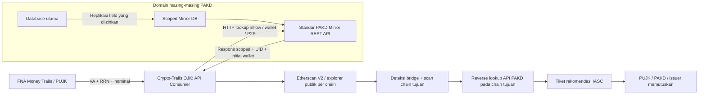

# OJK IASC Crypto-Trails · Scoped PAKD API & Multichain PoC

Aplikasi lokal untuk **FNA’s Money Trails → API di atas Scoped Mirror DB milik PAKD → Multichain & Bridge Trailing → keputusan PUJK/PAKD**. Snapshot FNA, identitas dan data PAKD serta callback freeze adalah simulasi. Mode live membaca transaksi publik asli; ini bukan aplikasi resmi atau konektor operasional OJK/IASC.

## Arsitektur



**Crypto-Trails tidak membuka koneksi SQL ke database PAKD.** SQL hanya berada pada modul provider yang mensimulasikan domain PAKD. Consumer memakai `httpx` dan HTTP REST, termasuk serialisasi payload, validasi DTO, status HTTP, serta pencatatan latency. Untuk demo lokal, HTTP memakai `ASGITransport` ke aplikasi provider terpisah dalam satu proses; bukan koneksi jaringan ke server PAKD sungguhan. Router provider juga dipublikasikan pada aplikasi utama agar alur API-to-API terlihat di referensi OpenAPI lokal.

Prinsip minimisasi data diwujudkan melalui allowlist kolom dan respons terstruktur. Ini adalah desain teknis, bukan sertifikasi kepatuhan UU PDP atau bukti bahwa OJK/PAKD telah mengaktifkan replikasi produksi.

## Menjalankan

Python 3.11+; diuji pada Python 3.12 macOS ARM64. Tanpa Docker, CDN, Node.js atau database server.

```bash
git clone https://github.com/cesartputra/crypto-trails.git
cd crypto-trails
python3 -m venv .venv
source .venv/bin/activate
python -m pip install -r requirements-dev.txt \
  && python -m pytest -q \
  && python -m uvicorn main:app --host 127.0.0.1 --port 8000
```

Pada Mac demo yang sudah disiapkan, gunakan `source .venv-offline/bin/activate`. Lingkungan ini hanya lokal dan bergantung pada runtime pembuatnya; tidak disertakan Git/ZIP. Tidak ada dependensi baru untuk refactor ini. Instalasi awal tetap memerlukan akses PyPI. Error koneksi indeks paket tidak diperbaiki dengan mematikan verifikasi TLS.

Buka [dashboard](http://127.0.0.1:8000/), [referensi API lokal](http://127.0.0.1:8000/docs), atau [OpenAPI](http://127.0.0.1:8000/openapi.json). `bash start.command` menyediakan launcher runtime loopback; Ctrl+C menghentikan server. Setelah mengganti source atau konfigurasi, restart server sebelum me-refresh browser.

## Light dan Dark mode

Tombol tema di header memilih Light/Dark. Pilihan disimpan di localStorage browser; pada kunjungan pertama mengikuti preferensi sistem. Tema tidak menyimpan API key atau data perkara.

## `.env` dan provider explorer

Salin `.env.example` ke `.env` bila belum ada, kemudian isi key secara lokal:

```dotenv
ETHERSCAN_API_KEY=
ETHERSCAN_BASE_URL=https://api.etherscan.io/v2/api
ETHERSCAN_FALLBACK_EXPLORER_URL=https://eth.blockscout.com/api
```

`.env` di folder `main.py` dibaca otomatis. Environment shell lebih utama; key opsional pada UI berlaku untuk request tersebut saja. Key tidak dimasukkan ke graph, log API PAKD, localStorage, ekspor atau error validasi. File `.env` diabaikan Git; jangan membagikan file yang telah berisi key.

Dengan key, klien memakai **Etherscan V2 `chainid` sesuai jaringan**. Tanpa key, fallback dipilih per chain dari allowlist HTTPS resmi. URL Ethereum pada variabel fallback tidak digunakan untuk menyamar sebagai chain lain.

| Chain | ID | Explorer | Fallback tanpa key |
| --- | --- | --- | --- |
| Ethereum | 1 | etherscan.io | eth.blockscout.com |
| BSC | 56 | bscscan.com | Memerlukan key Etherscan; tidak ada fallback BSC yang diasumsikan |
| Polygon | 137 | polygonscan.com | polygon.blockscout.com |
| Arbitrum | 42161 | arbiscan.io | arbitrum.blockscout.com |
| Optimism | 10 | optimistic.etherscan.io | optimism.blockscout.com |
| Base | 8453 | basescan.org | base.blockscout.com |
| TRON | null / fixture `tron` | tronscan.org | Skenario TRC-20 sintetis saja; bukan endpoint EVM live |

Ketersediaan chain dan kuota tergantung paket serta kebijakan provider. Dukungan URL V1 hanya kompatibilitas Ethereum; gunakan V2 untuk multichain. Fallback publik dapat gagal, berubah, atau terlambat mengindeks. Tidak ada jaminan selalu tersedia dan tidak ada transaksi demo yang disisipkan sebagai hasil live.

## Scoped Mirror DB & REST API PAKD

Provider memakai SQLite nyata yang di-seed saat startup. Tiga tabel mencakup hanya kolom scoped:

| Tabel | Kolom yang direplikasi |
| --- | --- |
| `ojk_scoped_fiat_inflows` | pakd_code, inflow_id, va_or_account_number, rrn_reference, amount_idr, inflow_timestamp, intake_channel, user_uid, kyc_nik_masked, kyc_name_masked, remaining_fiat_balance_idr |
| `ojk_scoped_crypto_withdrawals` | withdrawal_id, pakd_code, user_uid, linked_inflow_id, token_symbol, crypto_amount, source_chain, source_chain_id, withdrawal_tx_hash, initial_wallet_address, withdrawal_timestamp, remaining_crypto_balance |
| `ojk_scoped_wallet_registry` | wallet_address, chain, chain_id, pakd_code, user_uid, kyc_nik_masked, wallet_role, p2p_offramp_pujk_name, p2p_offramp_account_number |

Daftar `EXCLUDED_INTERNAL_PAKD_FIELDS` hanya menampilkan **nama kolom yang dikecualikan**, seperti password_hash, api_secret, internal_orderbook, fee_tier, cold_wallet_private_key dan device_imei. Nilai kolom internal tersebut tidak di-seed, tidak disinkronkan, dan tidak dikirim dalam respons/log.

Consumer menyediakan `consume_pakd_inflow_lookup_api`, `consume_pakd_wallet_reverse_lookup_api`, dan `consume_pakd_p2p_lookup_api`. Forward lookup mencocokkan VA/RRN/nominal tepat serta relasi inflow-withdrawal. Reverse lookup menyertakan chain agar alamat EVM yang sama pada dua jaringan tidak dianggap satu record. Hasil ambigu ditolak. Whitelist withdrawal menunjukkan alamat terdaftar, bukan bukti kendali wallet.

Log panggilan tersimpan **per trace**, berisi endpoint, payload request, status HTTP, latency, field scoped dan payload respons. Modal **Inspector PAKD Mirror API & Scoped Schema** menampilkan log tersebut serta perbandingan kolom yang disertakan/dikecualikan. Preview juga diperoleh melalui consumer API. Semua identitas, NIK/nama tersamar, rekening, saldo dan relasi nasabah di provider merupakan seed sintetis.

## Live Multichain & Cross-Chain Bridge

1. Buka tab **Live Multichain Wallet Tracker**, pilih Source Chain dan wallet EVM publik.
2. Atur key melalui `.env` atau UI, pilih 1/2 hop dan filter aset.
3. Aktifkan **Auto-Scan Cross-Chain Bridge ke Jaringan EVM Lain** untuk memeriksa aktivitas alamat yang sama pada chain lain.
4. Node memiliki badge chain. Klik wallet/garis untuk provenance dan tautan explorer yang sesuai chain.
5. Hulu FNA/PAKD opsional pada hasil live hanya ilustrasi sintetis; bukan respons API PAKD atau withdrawal yang membuktikan asal seed wallet.

Deteksi memakai kamus kontrak bridge **yang terikat chain dan memiliki sumber publik**. Ketika transfer menyentuh kontrak bridge yang dikenal, node ditandai `BRIDGE_PROTOCOL`. Pivot memeriksa penerimaan pada alamat yang sama di jaringan lain dalam rentang waktu 2 jam sesudah transaksi sumber, aset yang sama dan rentang nominal 80–105%, lalu melanjutkan outgoing trailing di chain tujuan.

**Kecocokan alamat dan waktu adalah kandidat korelasi, bukan bukti settlement bridge.** Garis pivot live diberi status `CANDIDATE_UNVERIFIED`, mencantumkan kedua referensi transaksi aktual dan keterbatasan pencocokan. Nilai transfer atau simbol serupa tidak membuktikan bahwa dana tersebut sama. Aktivitas lintas-chain tanpa bukti bridge tetap ditampilkan sebagai aktivitas terpisah. Konfirmasi operasional memerlukan decoder event/message bridge atau bukti settlement protokol; token swap, fee dan relayer dapat mengubah jumlah/alamat penerima.

Engine mengambil `txlist`, `tokentx`, dan saldo native sesuai chain. Token USDT/USDC terikat kontrak chain masing-masing; tidak mengandalkan simbol saja. Decimal menjaga presisi. Hash/log identity mencakup chain agar tidak saling menimpa. Budget 36 request, 64 node, 128 edge, sekitar 2 request/detik dan deadline 90 detik menjaga demo tetap terbatas; metadata melaporkan truncation/chain yang tidak tersedia. Ini bukan penarikan riwayat penuh, tidak mencakup seluruh internal transfer/NFT, dan tidak menghitung recovery/taint dari aktivitas publik.

## Skenario terpandu dan governance

Enam preset: empat kasus awal tetap tersedia (P2P full-cycle, direct VA/loopback, DEX/cold wallet, golden period), ditambah dua kasus bridge yang menampilkan Ethereum → bridge → Arbitrum/BSC → hop lanjutan → loopback PAKD. Semua transaksi dan relasi cross-chain pada preset adalah sintetis yang secara eksplisit ditandai sebagai skenario.

FNA tetap sumber handoff rekening bank. IASC mengirim rekomendasi; PUJK/PAKD atau issuer terkait memutuskan. Status request: `NOT_SENT` → `SENT_WAITING_DECISION` → approve/partial/reject oleh institusi. Pengiriman tidak menaikkan confirmed frozen. Nominal persetujuan dibatasi permohonan dan saldo eligible. Replay identik idempoten; keputusan terminal bertentangan ditolak. Hold P2P hanya pada order terkait. Draft issuer tidak menandatangani atau mengirim transaksi.

Nilai IDR/probabilitas pada preset adalah asumsi demo dengan kurs tetap, bukan jaminan pengembalian. Hasil live tidak membuat tiket freeze otomatis. Input handoff manual dapat mencocokkan record scoped melalui API tetapi asal FNA tetap belum terverifikasi dan tidak menghasilkan rekomendasi otomatis.

## Endpoint dan modul

| Endpoint | Fungsi |
| --- | --- |
| `GET /api/v1/trail/scenarios` | Katalog preset handoff |
| `POST /api/v1/trail/trace-report` | FNA handoff → consumer API PAKD → graph skenario |
| `POST /api/v1/trail/live-etherscan` | wallet_address, source_chain, auto_scan_cross_chain, max_hops, token_filter, direction, etherscan_api_key?, simulate_fna_and_mirror_origin |
| `POST /api/v1/pakd-mirror-api/{pakd_code}/inflow-lookup` | Endpoint provider lookup inflow scoped |
| `POST /api/v1/pakd-mirror-api/{pakd_code}/wallet-lookup` | Endpoint provider reverse wallet scoped |
| `POST /api/v1/pakd-mirror-api/{pakd_code}/p2p-lookup` | Endpoint provider settlement P2P scoped |
| `GET /api/v1/mirror-db/records` | Consumer mengambil schema/preview scoped dari provider |
| `GET /api/v1/trail/address/{address}/expand` | Ekspansi trace scoped ke chain; live EVM opsional |
| `POST /api/v1/governance/send-freeze-request` | Dispatch rekomendasi simulasi |
| `POST /api/v1/governance/simulate-institution-decision` | Callback keputusan institusi simulasi |
| `POST /api/v1/recovery/execute-freeze` | 410 Gone; tidak ada direct auto-freeze |

`pakd_scoped_mirror_provider.py` memiliki SQLite/DTO/router PAKD; `pakd_api_consumer.py` hanya menangani HTTP consumer dan log; `p2p_and_pakd_bridge.py` menghubungkan handoff dan API PAKD; `chains.py` mendefinisikan jaringan/explorer; `etherscan_client.py` membaca multichain dan pivot; `scenario_trailer.py` mengolah ledger sintetis; `recovery_action.py` menjaga keputusan institusi.

## Cost, pengujian dan batas PoC

Desain ini mengurangi kebutuhan lisensi label vendor untuk resolusi nasabah domestik dengan menggunakan API scoped milik PAKD dan transaksi publik. Integrasi produksi tetap membutuhkan perjanjian akses, API authentication/mTLS, otorisasi perkara, audit, retensi, monitoring dan kualitas replikasi masing-masing PAKD. Demo gratis tidak membuktikan biaya produksi nol atau menggantikan intelligence global.

Validasi final: **176 tes pytest lulus**; Light/Dark mode, penyimpanan tema, inspector API dan dua skenario bridge juga diperiksa melalui browser.

Jalankan `python -m pytest -q`. Tes memakai SQLite provider nyata, HTTP ASGI dan mock explorer agar tetap offline; menguji allowlist respons/log, isolasi PAKD/chain, forward/reverse matching, pivot kandidat dan trailing chain tujuan, URL explorer, batas sumber daya, perlindungan key, serta regresi governance. Smoke jaringan dilakukan terpisah. Pemeriksaan tema opsional: `node tests/frontend_theme_selfcheck.cjs`. Peringatan deprecation Starlette TestClient/httpx tidak menggagalkan tes.

Smoke jaringan pada 22 Oktober 2026: fallback Ethereum berhasil diakses; endpoint fallback Arbitrum, Base, Optimism dan Polygon belum dapat diakses dari jaringan pengujian. Routing Etherscan V2 dan fallback setiap chain diuji dengan HTTP mock. Akses nyata key Etherscan Anda dan settlement bridge belum diverifikasi.

State 128 trace/1 jam, database in-memory dan satu proses; restart menghapus state. Endpoint provider belum memakai autentikasi produksi. Jalankan pada loopback dengan data sintetis. Identitas PAKD nyata, key Etherscan berbayar, dan settlement bridge terkonfirmasi tidak diasumsikan sudah diuji.

Referensi: [Etherscan V2](https://docs.etherscan.io/introduction), [chain yang didukung](https://docs.etherscan.io/supported-chains), [rate limits](https://docs.etherscan.io/rate-limits), [Blockscout account API](https://docs.blockscout.com/devs/apis/rpc/account), [Across contracts](https://docs.across.to/chains-and-contracts). Referensi kontrak bridge lain dicantumkan pada metadata kamus. Dokumentasi diperiksa pada 22 Oktober 2026.
