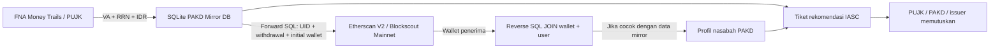

# In-House OJK Crypto-Trails · PoC

Pelacakan tiga zona **FNA’s Money Trails → PAKD Mirror DB SQLite → Ethereum Mainnet via Etherscan/Blockscout**. Tidak memakai layanan Arkham. Aplikasi lokal ini menggabungkan empat skenario sintetis dengan mode baca transaksi blockchain asli. Nama OJK/IASC menjelaskan arsitektur yang diminta; ini bukan aplikasi resmi atau konektor produksi lembaga tersebut.

**Keputusan freeze tetap milik PUJK/PAKD/issuer terkait.** IASC hanya menyiapkan tiket rekomendasi. Pengiriman dan callback keputusan dalam PoC adalah simulasi dan tidak mengubah dana nyata.

## Menjalankan

Python 3.11+ (diuji dengan Python 3.12 pada macOS ARM64). Tidak perlu Docker, Node.js, CDN, atau database server. SQLite tersedia dari standard library Python.

```bash
git clone https://github.com/cesartputra/crypto-trails.git
cd crypto-trails
python3 -m venv .venv
source .venv/bin/activate
python -m pip install -r requirements-dev.txt \
  && python -m pytest -q \
  && python -m uvicorn main:app --host 127.0.0.1 --port 8000
```

Buka [dashboard lokal](http://127.0.0.1:8000/) dan [OpenAPI JSON](http://127.0.0.1:8000/openapi.json). `bash start.command` menyediakan launcher runtime sederhana; hentikan dengan Ctrl+C. Instalasi awal perlu akses PyPI. Error `Connection reset by peer` sebelum paket terbaca berarti akses indeks paket gagal; pesan lanjutan `from versions: none` tidak cukup untuk menyimpulkan bahwa pin versi tidak tersedia. Jangan menonaktifkan verifikasi TLS.

Pada Mac demo yang sudah disiapkan, aktifkan `source .venv-offline/bin/activate` sebagai pengganti `.venv`. Lingkungan offline tersebut hanya lokal, tidak disertakan Git/ZIP, dan bergantung pada runtime Python yang digunakan saat pembuatannya.

## API key di `.env`

Salin `.env.example` ke `.env` jika belum tersedia, lalu isi:

```dotenv
ETHERSCAN_API_KEY=
ETHERSCAN_BASE_URL=https://api.etherscan.io/v2/api
ETHERSCAN_FALLBACK_EXPLORER_URL=https://eth.blockscout.com/api
```

Aplikasi membaca `.env` di folder `main.py` otomatis. Environment shell memiliki prioritas di atas nilai file. Kunci opsional pada request/UI mengesampingkan konfigurasi server untuk permintaan itu saja; nilai kosong memakai konfigurasi server. Kunci tidak disimpan pada graph, log UI, localStorage, atau respons error validasi. `.env` diabaikan Git; jangan membagikan atau mengunggah file yang sudah berisi kunci.

Jika key terisi, klien memakai **Etherscan V2, chainid=1**. URL V1 `https://api.etherscan.io/api` juga dapat dikonfigurasi untuk kompatibilitas, tetapi layanan dapat menolak V1; gunakan V2 sebagai default. Jika key UI dan server kosong, klien otomatis memakai **Blockscout Ethereum Mainnet publik**, tanpa mengubah hasil menjadi transaksi simulasi. Provider yang dipakai selalu ditampilkan. Key tidak dikirim ke Blockscout.

Akses publik tetap dapat mengalami gangguan, pembatasan kuota, keterlambatan indeks atau perubahan kebijakan. Tidak ada jaminan selalu tersedia. Kegagalan provider menghasilkan HTTP 502 beserta pesan aman, bukan graph demo yang menyamar sebagai hasil live.

## Tiga zona dan SQL Mirror DB



Zona 1 berakhir di VA/rekening penampungan PAKD. Modul mengimpor snapshot FNA; tidak menggantikan mesin bank tracing FNA. Zona 2 memakai database SQLite in-memory nyata yang di-seed ketika aplikasi dimuat. Empat tabelnya:

| Tabel | Isi |
| --- | --- |
| `mirror_pakd_users` | PAKD, UID, NIK tersamar, nama/telepon sintetis, status KYC, sisa saldo IDR |
| `mirror_pakd_fiat_deposits` | Deposit ID, PAKD/UID, VA/rekening, RRN, nominal IDR, waktu dan intake |
| `mirror_pakd_wallets` | Address + chain, PAKD/UID, custodial deposit address atau withdrawal whitelist |
| `mirror_pakd_withdrawals` | Withdrawal ID, PAKD/UID, token/jumlah, chain, hash, initial wallet, waktu dan korelasi deposit ID |

`lookup_deposit_by_fna_handoff(va_number, rrn_reference, amount_idr)` menjalankan SQL berparameter dengan kecocokan tepat VA/RRN/nominal; hasil ambigu ditolak. Nominal disimpan sebagai teks desimal kanonis, bukan float SQLite. Relasi deposit ID menghindari pemasangan sembarang withdrawal milik UID yang sama. Bridge juga memvalidasi ledger, jendela waktu dan kronologi skenario.

`match_wallet_in_mirror_db(wallet_address, chain="ETHEREUM_ERC20")` menjalankan JOIN wallet/user, dengan normalisasi alamat EVM dan pemisahan jaringan. Pencocokan withdrawal whitelist menunjukkan alamat terdaftar, bukan otomatis bukti kendali wallet. `add_wallet(...)` menyediakan penambahan dinamis untuk profil yang sudah tersedia; pergantian pemilik mapping ditolak. `get_mirror_db_preview()` membatasi preview setiap tabel hingga 100 baris.

**Seluruh profil, saldo, RRN, KYC dan relasi wallet dalam SQLite ini adalah seed sintetis.** Pintu/Reku disertakan sebagai contoh profil, selain PAKD pada skenario. Kecocokan reverse pada hasil live adalah kecocokan teknis dengan seed demo, bukan pembukaan identitas nasabah nyata. Akses mirror operasional seluruh PAKD merupakan arsitektur target dari brief, bukan klaim bahwa OJK sudah menyediakan koneksi tersebut.

## Real Live Wallet Trailing

1. Buka tab **Live Wallet Tracker**. Isi wallet Ethereum `0x` + 40 digit heksadesimal atau klik salah satu preset alamat mainnet publik.
2. Isi key di `.env`, atau biarkan kosong untuk Blockscout. Key opsional pada UI berlaku hanya pada request itu.
3. Pilih 1/2 hop dan aset Semua, ETH atau USDT. API juga menerima USDC dan arah `BOTH`; UI memakai `OUTBOUND`.
4. Opsi **Sertakan Hulu FNA Money Trails & PAKD Mirror DB** menambahkan node/edge ilustrasi sintetis. Opsi ini tidak memasukkan wallet pilihan ke database atau mengklaim adanya withdrawal PAKD nyata.
5. Jalankan live trace. Klik node untuk tautan `etherscan.io/address/...`; klik garis untuk hash, jumlah, waktu dan tautan `etherscan.io/tx/...`. Tautan bukti transaksi asli hanya ditampilkan untuk rekaman live.
6. Tombol **Lihat Tabel PAKD Mirror DB** membuka empat tabel SQLite; node PAKD pada skenario menampilkan hasil JOIN, UID/NIK tersamar, waktu deposit dan initial wallet.

Klien mengambil `account/txlist` untuk ETH, `account/tokentx` untuk ERC-20, dan `account/balance` untuk saldo ETH wallet yang diperluas. Nilai dikonversi dari integer menggunakan Decimal dan `tokenDecimal`; filter USDT/USDC mengikat kontrak kanonis, bukan hanya simbol yang dapat dipalsukan token lain. Transfer native gagal dan record tidak valid dilewati. Deduplikasi memakai hash + kontrak/logIndex bila tersedia; jika logIndex tidak disediakan provider, fingerprint dan urutan baris dipakai dengan peringatan keterbatasan.

Hasil dibatasi halaman terbaru 15 record per jenis/wallet, 24 request, 64 node dan 128 edge. API membatasi 1–2 hop; algoritma Python dapat dipanggil hingga 3 hop. Penjadwalan HTTP dibatasi sekitar 2 request/detik pada satu proses, timeout per request 10 detik, deadline trace 75 detik. Tidak mengambil riwayat penuh, internal ETH transfers, NFT, atau saldo token ERC-20. Counterparty pada hop terakhir belum tentu memiliki saldo yang telah diambil. Saldo ETH saat ini tidak sama dengan nilai transfer historis atau dana yang dapat dipulihkan.

Label publik internal hanya konteks dari sumber terbuka yang tercantum pada metadata; tidak membuktikan identitas pengguna exchange. Tidak ada tebakan alamat hot wallet Indodax/Tokocrypto tanpa sumber terverifikasi. Wallet di luar mirror ditampilkan sebagai belum teratribusi. Multi-hop menunjukkan relasi transaksi, bukan bukti bahwa setiap dana merupakan hasil kejahatan. Hasil live tidak membuat skor taint, kurs IDR, nilai recovery atau tiket freeze otomatis.

## Empat skenario dan governance

Preset tetap deterministik dan offline: FNA → SQL Mirror DB PAKD → ledger on-chain **sintetis** → rekomendasi IASC → keputusan institusi. Dua preset TRON yang dipertahankan adalah histori demo; mesin live hanya Ethereum Mainnet.

| Preset | Alur | Potensi snapshot demo |
| --- | --- | --- |
| P2P full cycle | Merchant/escrow, split TRON, P2P off-ramp, saldo BRI dan PAKD | Rp164 juta dari Rp180 juta |
| Direct VA / loopback | VA Tokocrypto, withdrawal Ethereum, reverse JOIN deposit Indodax | Rp120 juta |
| DEX / cold wallet | P2P, Ethereum/Uniswap, cold wallet, draft issuer | Rp176 juta dari Rp250 juta |
| Golden period | Hold escrow order Rp60 juta + exposure wallet Rp35 juta | Rp95 juta; belum ada dana dikonfirmasi |

Kurs fixture Rp16.000/USDT, biaya dan probabilitas adalah asumsi demo. Pada input handoff manual, VA/RRN/nominal tetap dicari melalui SQL. Jika cocok, referensi UID/initial wallet seed ditampilkan pada gateway; asal dana FNA tetap belum terverifikasi. Tidak ada ledger skenario atau rekomendasi freeze yang dibuat dari input manual.

Status governance: `NOT_SENT` → `SENT_WAITING_DECISION` → `APPROVED_FREEZE_BY_INSTITUTION` / `PARTIAL_FREEZE_BY_INSTITUTION` / `REJECTED_BY_INSTITUTION`. Pengiriman tiket tidak menaikkan confirmed frozen. Persetujuan dibatasi nominal permohonan dan saldo eligible; keputusan terminal immutable dengan replay identik idempoten. Partial issuer ditolak untuk scope pembatasan token pada seluruh alamat. Hold merchant P2P ditargetkan pada order, bukan seluruh bisnis.

Evidence packet memuat handoff, PAKD trails, ledger dan target dengan digest snapshot; callback adalah simulasi lokal. Draft issuer tidak menyimpan private key, menandatangani, atau mengirim transaksi. `confirmed_frozen_amount_idr` berarti nominal keputusan **simulasi**, bukan dana nyata yang sudah dibekukan.

## Endpoint dan modul

| Method | Endpoint | Fungsi |
| --- | --- | --- |
| GET | `/api/v1/health` | Mode provider, mirror dan governance |
| GET | `/api/v1/trail/scenarios` | Empat preset handoff |
| POST | `/api/v1/trail/trace-report` | Handoff FNA; graph skenario/SQL mirror |
| POST | `/api/v1/trail/live-etherscan` | `{wallet_address, etherscan_api_key?, max_hops?, token_filter?, direction?, simulate_fna_and_mirror_origin?}` |
| GET | `/api/v1/mirror-db/records` | Preview empat tabel SQLite dan jumlah baris |
| GET | `/api/v1/trail/address/{address}/expand?trace_id=...&chain=...&live=false` | Ekspansi fixture; `live=true` hanya Ethereum via konfigurasi server |
| POST | `/api/v1/governance/send-freeze-request` | `{trace_id, request_id}`; rekomendasi dan evidence |
| POST | `/api/v1/governance/simulate-institution-decision` | Keputusan institusi simulasi setelah dispatch |
| POST | `/api/v1/recovery/execute-freeze` | 410 Gone; tidak ada direct auto-freeze |

`schemas.py` memvalidasi kontrak; `bank_trailer.py` mengimpor snapshot FNA; `pakd_mirror_db.py` menjalankan SQL; `p2p_and_pakd_bridge.py` menghubungkan intake, withdrawal dan loopback; `scenario_trailer.py` menjaga ledger/taint sintetis; `etherscan_client.py` membaca mainnet; `recovery_action.py` menjaga state keputusan institusi. `main.py` mengorkestrasi dan menyajikan dashboard.

Respons live memakai `simulation=false`, `fna_handoff=null`, `live_metadata` provider/cakupan/waktu pengambilan, serta provenance per node/edge. Jika hulu ilustrasi dicentang, record hulu tetap `simulation=true`. Total IDR/recovery numerik tetap nol untuk kompatibilitas schema; UI menampilkan jumlah wallet/transfer dan tidak menyajikannya sebagai estimasi pemulihan.

## Cost & Effort — Mirror DB + Etherscan dibanding Arkham

| Pendekatan | Biaya dan upaya |
| --- | --- |
| Arkham / lisensi intelligence pihak ketiga | Memerlukan akses/kontrak vendor; cakupan label dan tarif harus diperiksa langsung pada vendor, tidak diasumsikan gratis |
| Mirror DB PAKD | SQLite demo tidak membutuhkan biaya layanan database. Integrasi nyata tetap membutuhkan replika/ETL, perjanjian akses, otorisasi, audit, sinkronisasi dan kualitas data dari setiap PAKD |
| Etherscan/Blockscout | Transaksi publik dapat dibaca dengan key sesuai paket Etherscan atau fallback publik tanpa key. Kuota/ketersediaan mengikuti provider; tidak ada jaminan seluruh kebutuhan operasional bebas biaya |

Efisiensi desain berasal dari resolusi UID/wallet pada data PAKD sendiri dan pembacaan transaksi publik. Ini mengurangi ketergantungan pada lisensi label eksternal untuk forward/reverse resolution domestik. Ia tidak menggantikan intelligence global, clustering pemilik wallet, bukti kontrol alamat, de-anonimisasi atau penelusuran transformasi lintas chain. Biaya produksi tidak dapat dinilai hanya dari keberhasilan demo SQLite.

## Pemeriksaan dan batas operasional

Jalankan `python -m pytest -q`. Pengujian memakai SQLite nyata dan HTTP mock untuk parsing ETH/ERC-20, filter kontrak, deduplikasi, hop/budget, error/kredensial, endpoint live, pemisahan hulu sintetis, dan regresi skenario/governance. Smoke test mainnet dilakukan terpisah agar suite tetap dapat berjalan offline. Validasi final: 162 tes pytest lulus, pemeriksaan sintaks JS/Bash dan self-check frontend lulus; browser menampilkan transfer Blockscout asli dengan link hash Etherscan serta hulu yang jelas bertanda simulasi. Ada peringatan deprecation dari Starlette TestClient terhadap httpx; bukan kegagalan tes.

State maksimum 128 trace/1 jam dan SQLite in-memory hilang saat restart. Aplikasi hanya untuk satu proses lokal; tidak memiliki login lembaga, callback mitra terautentikasi, audit durable atau retensi produksi. Jangan membuka port ke jaringan publik dengan identitas perkara nyata. Upgrade penyimpanan, akses dan integrasi harus dilakukan sebelum penggunaan operasional.

Referensi: [Batas request Etherscan](https://docs.etherscan.io/rate-limits), [Etherscan txlist](https://docs.etherscan.io/api-reference/endpoint/txlist), [Etherscan tokentx](https://docs.etherscan.io/api-reference/endpoint/tokentx), [Blockscout account API](https://docs.blockscout.com/devs/apis/rpc/account), [Uniswap V2 deployment](https://docs.uniswap.org/contracts/v2/reference/smart-contracts/v2-deployments), [portal IASC](https://iasc.ojk.go.id/). Dokumentasi provider diperiksa pada 22 Oktober 2026.
