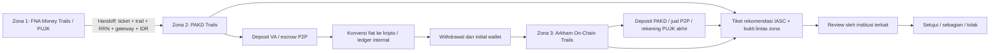

# PAKD Trails & On-Chain Arkham Tracker

Modul ekstensi **downstream FNA’s Money Trails** untuk demonstrasi arsitektur IASC: menerima handoff terakhir jalur PUJK, membuka jejak ledger internal PAKD, menemukan initial wallet, lalu menelusuri transaksi publik menggunakan adapter Arkham. Nilai utama inovasi ini adalah **PAKD Trails** sebagai jembatan antara jejak rekening PUJK dan blockchain.

Arsitektur acuan pada brief menempatkan FNA’s Money Trails pada jalur rekening PUJK dan mengusulkan penambahan cakupan PAKD Trails. PoC ini mengikuti batas tersebut: **bukan pengganti FNA, bukan konektor FNA resmi, dan tidak mengeksekusi pembekuan sepihak atas nama IASC**. Status penerapan FNA di IASC serta cakupan PAKD pada sistem internal IASC mengikuti konteks yang diberikan dalam brief; tidak diklaim telah diverifikasi lewat akses sistem produksi.

Seluruh handoff, RRN, nama, rekening, NIK tersamar, KYC, order, saldo, alamat dan hash dalam empat preset adalah **data sintetis**. Pengiriman tiket dan callback keputusan juga simulasi lokal. Tidak ada instruksi ke bank, PAKD, issuer, atau blockchain.

## Menjalankan

Python 3.11+; pengembangan diuji dengan Python 3.12 pada macOS ARM64. Tidak memerlukan Docker, database, Node.js, atau CDN.

```bash
git clone https://github.com/cesartputra/crypto-trails.git
cd crypto-trails
python3 -m venv .venv
source .venv/bin/activate
python -m pip install -r requirements-dev.txt
python -m pytest -q
python -m uvicorn main:app --host 127.0.0.1 --port 8000
```

Buka [dashboard](http://127.0.0.1:8000) dan [OpenAPI JSON](http://127.0.0.1:8000/openapi.json). Untuk ZIP, masuk ke folder yang berisi `main.py`. Di Mac, `bash start.command` menyiapkan dependensi runtime bila perlu dan menjalankan satu proses server loopback; `Ctrl+C` menghentikannya. Pemasangan pertama memerlukan internet. Setelah dependensi tersedia, semua preset dan aset dashboard berfungsi offline tanpa API key.

## Batas tiga zona



| Zona | Kepemilikan proses | Peran modul |
| --- | --- | --- |
| 1 · FNA’s Money Trails (PUJK) | Jejak rekening dari sumber FNA dan keputusan masing-masing PUJK | Mengimpor snapshot fixture yang sudah tersedia; menampilkan penolakan PUJK ketika saldo telah berpindah. Tidak menjalankan ulang bank tracing sebagai pengganti FNA |
| 2 · PAKD Trails | Ledger dan keputusan pada masing-masing PAKD | Mencocokkan RRN, gateway VA/rekening P2P, nominal dan waktu; menampilkan UID/KYC tersamar, deposit, konversi, P2P, sisa saldo, withdrawal dan initial wallet |
| 3 · On-Chain Crypto Trails | Transaksi publik dan intelligence Arkham; tindakan issuer memerlukan pihak berwenang | Menampilkan transfer, chain, hash, label dan taint. Membentuk evidence untuk review institusi, tanpa signing atau broadcast transaksi |

Nilai `node_zone` tetap `FIAT_BANK`, `CRYPTO_EXCHANGE_BRIDGE`, dan `ONCHAIN_WALLET`; legenda UI menjelaskan nama tiga zona di atas. Jejak FNA dan keputusan historis PUJK adalah bukti yang diimpor, bukan hasil pemanggilan API FNA oleh aplikasi ini. Rekening merchant P2P tidak boleh menjadi sasaran pemblokiran seluruh bisnis; rekomendasi hold hanya terkait order dan saldo escrow yang teramati.

## Kontrak handoff dan PAKD Trails

`FNAMoneyTrailHandoffInput` menggantikan kontrak input laporan mentah:

- Identitas perkara: `iasc_ticket_id`, `fna_trail_id`.
- Korban: `victim_pujk_name`, `victim_account_number`, `victim_account_name`.
- Titik terakhir FNA: `last_fna_pujk_name`, `last_fna_account_number`.
- Transaksi menuju PAKD/P2P: `pakd_gateway_va_or_account`, `fiat_transfer_amount_idr`, `fiat_transfer_timestamp`, `rrn_reference_number`.
- `scenario_id` opsional hanya untuk memilih fixture demo. Handoff manual tanpa data mitra menghasilkan data gap, bukan pencocokan KYC/order yang direkayasa.

Pencocokan PAKD harus unik pada RRN, gateway, nominal dan jendela waktu. RRN saja tidak membuktikan kecocokan jika rekening atau nominal berbeda. Perubahan material pada handoff preset ditolak. ID tiket IASC dapat ditentukan operator; identitas trail FNA dan informasi finansial tetap terikat pada fixture asalnya.

`PAKDInternalTrailRecord` mencatat nama PAKD, mekanisme intake (`DIRECT_VA_DEPOSIT`, `P2P_ON_RAMP_ESCROW`, `P2P_OFF_RAMP_SETTLEMENT`), UID, `kyc_nik_masked`, fiat masuk, token/jumlah pembelian, sisa saldo IDR, status withdrawal, chain, hash, dan initial wallet. Literal tambahan `ONCHAIN_DEPOSIT` diperlukan untuk loopback ke akun Indodax pada skenario 2: penerimaan kripto on-chain tidak boleh dilabeli deposit VA rupiah. `record_id`, `target_node_id`, serta metadata bukti menghubungkannya dengan graph. NIK lengkap tidak digunakan dalam fixture atau paket bukti.

Nominal menerima angka atau string JSON tetapi memakai **Decimal** di backend dan string desimal pada respons agar tidak kehilangan presisi uang. Ini juga berlaku pada requested/approved amounts. Rekening dan RRN adalah string; waktu wajib menyertakan offset, misalnya `2026-10-21T09:00:40+07:00`. Angka non-finite, negatif, berlebih, serta keputusan dengan nominal yang tidak konsisten ditolak.

## Tata kelola rekomendasi dan keputusan

**IASC menyiapkan dan mendispatch rekomendasi; PUJK/PAKD memutuskan.** Tidak ada perubahan saldo dibekukan hanya karena tiket telah dikirim.

| Status request | Arti | Nilai dana yang dicatat dibekukan |
| --- | --- | --- |
| `NOT_SENT` | Rekomendasi belum dikirim | 0 |
| `SENT_WAITING_DECISION` | Tiket beserta evidence menunggu review institusi | 0 |
| `APPROVED_FREEZE_BY_INSTITUTION` | Institusi menyetujui rekomendasi dalam simulasi callback | Nominal yang disetujui, dibatasi permohonan dan saldo teramati |
| `PARTIAL_FREEZE_BY_INSTITUTION` | Institusi menyetujui sebagian | Hanya nominal persetujuan parsial |
| `REJECTED_BY_INSTITUTION` | Institusi menolak, misalnya saldo kosong | 0 |

`InstitutionFreezeDecision` memisahkan `requested_amount_idr` dari `approved_frozen_amount_idr`, mencatat kategori/nama institusi, target node, catatan, unit pengambil keputusan dan timestamp. Identitas institusi serta unit berasal dari server, bukan field yang dapat dipalsukan client. Badge historis PUJK dari snapshot FNA dibedakan dari request baru di console.

Dua langkah API:

1. `send-freeze-request` mengubah request yang sah menjadi `SENT_WAITING_DECISION` dan menyimpan snapshot evidence FNA + PAKD Trails + Arkham beserta digest. Ini adalah dispatch simulasi, bukan pengiriman ke mitra.
2. `simulate-institution-decision` mendemokan callback institusi. Keputusan hanya dapat dibuat setelah dispatch. Persetujuan penuh dibatasi saldo eligible; parsial harus positif dan lebih kecil dari permohonan; penolakan bernilai nol. Request bersaldo eligible nol hanya dapat ditolak. Keputusan terminal tidak dapat diganti; replay identik idempoten, callback bertentangan ditolak.

Mengirim ulang request tidak menghapus keputusan yang sudah ada. `confirmed_frozen_amount_idr` menjumlahkan nominal yang disetujui dari saldo terminal yang terpisah, bukan nominal permohonan atau volume transfer antar-hop. Istilah confirmed pada PoC tetap merujuk **hasil callback simulasi**, bukan pembekuan dana nyata.

Issuer/global exchange menggunakan kategori `STABLECOIN_ISSUER_OR_GLOBAL_EXCHANGE`. Paket stablecoin merupakan **DRAFT** untuk review pihak tersebut. USDT memakai referensi fungsi berizin `addBlackList(address)`; `AddedBlackList` adalah event. USDC Ethereum memakai `blacklist(address)`. Pembatasan token issuer bersifat pada alamat, bukan API yang menerima nominal tertentu; karena itu keputusan parsial ditolak khusus untuk scope `ISSUER_REVIEW`, sementara PUJK/PAKD tetap memiliki tiga pilihan keputusan. Nilai crypto/IDR adalah exposure bukti; tidak ada private key, signing, atau broadcast. Mekanisme/native token dan kewenangan pihak terkait tetap harus diverifikasi pada integrasi operasional.

## Empat skenario demonstrasi

Seluruh skenario mengikuti FNA → PAKD Trails → Arkham → request IASC → keputusan institusi. Pilihan approve/partial/reject adalah simulasi untuk menilai workflow, bukan keputusan otomatis IASC.

| Preset | Jejak dan sasaran rekomendasi | Potensi pada snapshot |
| --- | --- | --- |
| 1 · P2P full cycle | Snapshot FNA dari BNI ke mule BCA, RRN menuju merchant; PAKD escrow 11.250 USDT; split TRON; jual P2P; rekening BRI akhir `034101009988111`. BRI dan PAKD menerima rekomendasi terpisah | BRI Rp144 juta + sisa PAKD 1.250 USDT = **Rp164 juta** dari Rp180 juta |
| 2 · Direct VA / loopback | Snapshot PUJK ke VA Tokocrypto; PAKD mencatat pembelian/withdrawal 7.500 USDT; dua wallet menuju deposit Indodax; keputusan ada pada PAKD terkait | **Rp120 juta** |
| 3 · DEX / cold wallet | Handoff P2P; PAKD membeli/menarik 15.600 USDT; Arkham fixture menunjukkan Uniswap dan cold wallet berisi 11.000 USDT; draf review issuer | **Rp176 juta** dari Rp250 juta |
| 4 · Golden period | Handoff Rp95 juta; PAKD menyisakan Rp60 juta dalam escrow, Rp35 juta sudah berada di initial wallet; hold ditargetkan pada order | **Rp95 juta**, cakupan potensi 100%; belum ada dana dikonfirmasi sebelum keputusan |

Kurs tetap fixture Rp16.000/USDT, bukan harga pasar. Skenario 1 settlement Rp160 juta menyisakan saldo BRI Rp144 juta; sisa Rp16 juta sudah tidak tersedia pada snapshot. Skenario 3 mengenakan biaya konversi sintetis Rp400 ribu. Potensi recovery dan probabilitas skenario merupakan asumsi demo, bukan jaminan pengembalian.

Untuk demo: pilih preset, inspeksi badge PUJK dari FNA, buka detail PAKD Trails, lalu pilih target rekomendasi. Kirim tiket dan tunjukkan status menunggu serta confirmed tetap nol. Pilih salah satu keputusan institusi dan periksa nominal aktual. Muat ulang preset untuk memperagakan cabang keputusan lain. Input handoff manual, animasi, expand address, pan/zoom/fit, dan ekspor bukti tetap tersedia.

## Endpoint dan migrasi

| Method | Endpoint | Kontrak |
| --- | --- | --- |
| GET | `/api/v1/health` | Mode simulasi dan ketersediaan adapter Arkham |
| GET | `/api/v1/trail/scenarios` | Empat preset dengan properti `handoff` |
| POST | `/api/v1/trail/trace-report` | `FNAMoneyTrailHandoffInput`; graph tiga zona, `pakd_trails`, `governance_requests`, metrik potensi/confirmed |
| GET | `/api/v1/trail/address/{address}/expand?trace_id=...&chain=...` | Ekspansi address yang termasuk trace |
| POST | `/api/v1/governance/send-freeze-request` | `{trace_id, request_id}`; request dan evidence packet |
| POST | `/api/v1/governance/simulate-institution-decision` | `{trace_id, request_id, decision, approved_frozen_amount_idr?, institution_decision_notes?}` |
| POST | `/api/v1/recovery/execute-freeze` | **410 Gone**; endpoint lama tidak dapat membekukan node |

Perubahan kontrak disengaja: input Tahap 4 lama harus dipetakan upstream ke FNA handoff; `scenarios[].report` menjadi `scenarios[].handoff`, `report_id` menjadi identitas tiket/trail, dan `recovery_actions` diganti `governance_requests`. Tidak ada fallback yang mengubah input lama menjadi bukti FNA palsu.

Contoh menjalankan trace dan mengirim rekomendasi dengan standard library Python:

```python
import json
from urllib.request import Request, urlopen

base = "http://127.0.0.1:8000"
def post(path, payload):
    req = Request(base + path, data=json.dumps(payload).encode(),
                  headers={"Content-Type": "application/json"})
    return json.load(urlopen(req))

presets = json.load(urlopen(base + "/api/v1/trail/scenarios"))
graph = post("/api/v1/trail/trace-report", presets["scenarios"][0]["handoff"])
recommendation = next(r for r in graph["governance_requests"]
                      if r["institution_category"] == "PUJK"
                      and float(r["requested_amount_idr"]) > 0)
payload = {"trace_id": graph["trace_id"], "request_id": recommendation["request_id"]}
sent = post("/api/v1/governance/send-freeze-request", payload)
assert sent["request"]["request_status"] == "SENT_WAITING_DECISION"
assert float(sent["confirmed_frozen_amount_idr"]) == 0
result = post("/api/v1/governance/simulate-institution-decision", {
    **payload, "decision": "APPROVED_FREEZE_BY_INSTITUTION"
})
print(result["request"]["decided_by_unit"], result["confirmed_frozen_amount_idr"])
```

## Modul dan batas PoC

| Berkas | Tanggung jawab |
| --- | --- |
| `schemas.py` | Kontrak handoff, PAKD internal trails, graph dan institution decisions |
| `scenarios.py` | Snapshot FNA, data PAKD/escrow, ledger on-chain dan saldo institusi sintetis |
| `services/bank_trailer.py` | Adapter snapshot FNA dan indikator merchant yang bersifat petunjuk, bukan vonis |
| `services/p2p_and_pakd_bridge.py` | PAKD intake matching dan ledger, withdrawal ke initial wallet, reverse lookup off-ramp |
| `services/arkham_client.py` | Adapter async read-only dan atribusi fixture yang menjaga konservasi dana |
| `services/recovery_action.py` | Rekomendasi, evidence packet dan state machine keputusan institusi |
| `main.py` | Orkestrasi trace/governance, penyimpanan sementara dan static dashboard |
| `static/`, `tests/` | Dashboard offline serta regression tests kontrak/ledger/governance |

Mode Arkham: tanpa `ARKHAM_API_KEY` tidak ada panggilan HTTP vendor. Preset selalu memakai fixture deterministik. `live=true` pada expand adalah opt-in read-only dan tidak menambah klaim taint, KYC, saldo recovery, atau keputusan institusi.

```bash
export ARKHAM_API_KEY='kunci-dari-vendor'
export ARKHAM_BASE_URL='https://api.arkm.com'
python -m uvicorn main:app --host 127.0.0.1 --port 8000
```

Host legacy default `https://api.arkhamintelligence.com` mengikuti brief awal; dokumentasi Arkham saat verifikasi mencantumkan `https://api.arkm.com`. Timeout dan hasil dibatasi; kredensial live belum dipakai. Label Arkham tidak menggantikan RRN, ledger PAKD, KYC atau bukti settlement bank. DEX/bridge memutus atribusi jika bukti transformasi belum tersedia. `taint_score_pct: null` berarti belum diketahui; saldo `NOT_FETCHED` tidak ditampilkan sebagai saldo nol.

State maksimum 128 trace dengan TTL satu jam, satu proses. Graph dibatasi 256 node/512 edge; live expand satu halaman maksimal 50 transfer. Restart menghapus trace/status. Callback simulasi bukan endpoint mitra produksi yang terautentikasi. Integrasi operasional memerlukan kontrak data FNA/PAKD, autentikasi dan otorisasi lembaga, verifikasi callback, audit durable, serta kebijakan retensi perkara. PoC hanya ditujukan untuk loopback dan data sintetis.

## Pemeriksaan refactor

Pada 22 Oktober 2026, **107 pengujian pytest lulus**: kontrak handoff, snapshot FNA read-only, kecocokan RRN/PAKD dan kronologi, empat skenario, konservasi taint, integritas paket bukti, batas nominal, isolasi request, idempotensi, serta atomicity kegagalan dispatch/keputusan. Sintaks JavaScript dan launcher Bash juga lulus.

Pemeriksaan browser mencakup empat preset, pending tetap Rp0 setelah dispatch, persetujuan parsial BRI Rp72 juta, persetujuan PAKD Indodax Rp120 juta, penolakan tanpa saldo, hold escrow golden period Rp60 juta, handoff manual tanpa bukti palsu, dan animasi sampai selesai. Console browser tidak mencatat error JavaScript. Pengujian Arkham menggunakan mock HTTP; ada satu peringatan deprecation upstream Starlette/TestClient terhadap httpx yang tidak menggagalkan pengujian. Tidak ada konektor mitra nyata yang diuji.

## Referensi arsitektur

- [Portal IASC OJK — bagaimana IASC bekerja](https://iasc.ojk.go.id/) menjelaskan peran koordinasi IASC, tindak lanjut lembaga keuangan dan pengawasan. Ini mendukung pemisahan dispatch/review pada desain, bukan spesifikasi API produksi.
- [FNA dan Proto — G20 TechSprint 2025](https://fna.fi/insights/fna-and-proto-win-2025-g20-techsprint) menjelaskan fungsi Money Trails dan ekspansi deployment. Artikel publik ini bukan bukti schema handoff atau status implementasi internal IASC saat ini.
- [Dokumentasi Arkham](https://arkm.com/api/docs), [kontrak/protokol Tether](https://tether.to/en/supported-protocols/), dan [Circle Blacklistable](https://github.com/circlefin/stablecoin-evm/blob/master/contracts/v1/Blacklistable.sol) menjadi referensi adapter dan draf issuer.

Arsitektur target serta cakupan PAKD yang ingin ditambahkan mengikuti brief pemilik proyek. Status hukum, kebijakan institusi, kontrak integrasi, dan kewenangan operasional tidak ditetapkan oleh status enum dalam PoC. Verifikasi referensi: 21 Oktober 2026.
