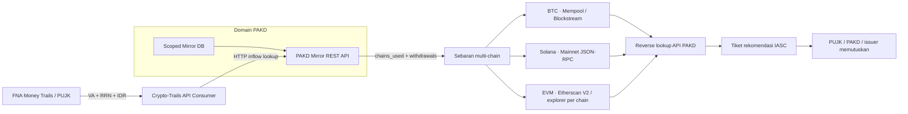

# Crypto-Trails · PAKD Multi-Chain Dispersal & Dedicated Scanners

Dashboard investigasi **FNA → PAKD Scoped Mirror REST API → Bitcoin / Solana / EVM Scanner → rekomendasi dan keputusan institusi**. Satu inflow Rupiah dapat terhubung ke beberapa withdrawal pada chain berbeda. UI menampilkan narasi singkat, kartu sebaran dan jalur per chain agar pembagian dana mudah dibaca.

PoC lokal ini bukan sistem resmi OJK/IASC. Handoff FNA, identitas nasabah PAKD, saldo serta keputusan freeze pada skenario adalah sintetis. Mode live membaca API publik asli dan tidak menyisipkan graph demo ketika provider gagal.

## Menjalankan

Python 3.11+; diuji pada Python 3.12 macOS ARM64. Tidak perlu Docker, database server, CDN atau framework JavaScript. SQLite dan validasi encoding memakai standard library; dependensi Python tetap sama.

```bash
git clone https://github.com/cesartputra/crypto-trails.git
cd crypto-trails
python3 -m venv .venv
source .venv/bin/activate
python -m pip install -r requirements-dev.txt \
  && python -m pytest -q \
  && python -m uvicorn main:app --host 127.0.0.1 --port 8000
```

Pada Mac demo yang sudah disiapkan, aktifkan `source .venv-offline/bin/activate` sebelum menjalankan server. Lingkungan offline hanya lokal dan bergantung pada runtime pembuatnya; tidak disertakan Git/ZIP. `bash start.command` adalah launcher runtime sederhana; Ctrl+C menghentikan server.

Buka [dashboard](http://127.0.0.1:8000/), [referensi API lokal](http://127.0.0.1:8000/docs), atau [kontrak OpenAPI](http://127.0.0.1:8000/openapi.json). Restart server setelah mengganti source, kemudian refresh browser. Instalasi awal memerlukan akses PyPI; jangan menonaktifkan verifikasi TLS untuk mengatasi kegagalan jaringan.

## Arsitektur dan minimisasi data



Aplikasi OJK bertindak sebagai **API consumer**, tanpa membuka koneksi SQL ke database PAKD. SQL hanya berada dalam `pakd_scoped_mirror_provider.py`. Demo menggunakan HTTP ASGI dalam satu proses untuk memisahkan provider/consumer; bukan koneksi ke server produksi PAKD. Endpoint provider tetap terlihat pada OpenAPI.

Tiga tabel scoped: `ojk_scoped_fiat_inflows`, `ojk_scoped_crypto_withdrawals`, dan `ojk_scoped_wallet_registry`. Withdrawal terikat pada `pakd_code`, `user_uid`, dan `linked_inflow_id`; satu inflow boleh memiliki beberapa withdrawal yang sah. Respons inflow API memuat `chains_used` dan daftar `withdrawals`, termasuk:

- ID withdrawal, chain/family dan scanner_provider.
- Token, jumlah Decimal dan `fiat_value_idr` pada snapshot demo.
- Hash withdrawal, initial address dan timestamp.

BTC/SOL tidak dihitung dengan kurs USDT Rp16.000. Setiap cabang memakai nilai fiat yang teratribusi pada withdrawal tersebut; volume transfer berulang antar-hop tidak dijumlahkan sebagai kerugian baru.

Allowlist respons menolak/menghapus field internal yang tidak termasuk scope. Nama kolom seperti `password_hash`, `api_secret`, `internal_orderbook`, `cold_wallet_private_key`, `device_imei`, dan `fee_tier` hanya ditampilkan dalam daftar pengecualian; nilainya tidak diakses atau disinkronkan. NIK dan nama nasabah disamarkan. Desain minimisasi ini bukan sertifikasi kepatuhan UU PDP.

Log API bersifat per trace: endpoint, request, status HTTP, latency, scoped fields dan respons. Semua detail teknis tersedia melalui modal **Log API & Mirror DB PAKD**, bukan memenuhi layar investigasi utama.

## Alur UI

1. **Handoff FNA:** pilih kasus. Detail rekening, RRN, VA dan waktu disimpan pada form opsional yang dapat dibuka.
2. **Cek PAKD Mirror API:** ringkasan menjelaskan nilai inflow dan sebaran chain dalam bahasa sederhana.
3. **Pelacakan scanner:** kartu BTC/Solana/EVM menunjukkan jumlah, initial address dan sumber scanner. Klik kartu/filter untuk fokus pada jalur terkait; pilih Semua Chain untuk melihat fan-out lengkap.
4. **Rekomendasi dan keputusan:** klik node untuk bukti dan kewenangan institusi. Pengiriman rekomendasi tidak langsung mengakui dana dibekukan.

Kanvas memakai swimlane horizontal per chain, dengan konteks FNA/PAKD bersama di sisi kiri. Bukti dan API JSON dipisahkan dari ringkasan. Tema Light/Dark di header disimpan dalam localStorage; kunjungan pertama mengikuti preferensi sistem. API key tidak disimpan di localStorage.

## Kasus default: Rp180 juta tersebar ke tiga chain

**BNI → mule BCA → VA Tokocrypto → tiga withdrawal:**

| Cabang | Nilai awal demo | Jalur akhir |
| --- | --- | --- |
| Bitcoin | Rp70 juta · 0,065 BTC | Initial BTC → wallet perantara → deposit BTC Indodax |
| Solana | Rp50 juta · 185 SOL | Initial SOL → deposit Pintu → P2P off-ramp ke rekening BRI; saldo akhir eligible Rp45 juta |
| Ethereum | Rp60 juta · 3.750 USDT | Initial ERC-20 wallet → unhosted wallet; draft permohonan review issuer |

Nilai awal cabang berjumlah Rp180 juta. Potensi terminal pada snapshot Rp175 juta: Rp70 juta di PAKD, Rp45 juta saldo BRI dan Rp60 juta exposure USDT. Tidak ada nominal dikonfirmasi sampai callback keputusan simulasi; tidak ada jaminan recovery.

Alamat, hash, identitas dan hubungan PAKD pada preset adalah sintetis, meskipun sebagian contoh alamat memakai format/alamat publik nyata. Jangan memakai mapping fixture sebagai bukti kepemilikan nasabah nyata. Enam preset sebelumnya juga dipertahankan: P2P full-cycle, direct VA/loopback, DEX/cold wallet, golden period serta dua bridge EVM Ethereum→Arbitrum/BSC. Semua memakai struktur `chain_dispersals` dan provenance scanner.

## Live Scanner: BTC, Solana, EVM

Pilih chain dan alamat yang sesuai, lalu jalankan live scanner. Contoh Solana berupa akun publik Wrapped SOL, bukan klaim identitas pengguna. Scanner berbeda digunakan sesuai keluarga chain:

| Family | Provider | Bukti explorer |
| --- | --- | --- |
| Bitcoin | Mempool.space REST; fallback Blockstream Esplora jika provider utama gagal | mempool.space/address/... dan /tx/... |
| Solana | api.mainnet-beta.solana.com JSON-RPC | solscan.io/account/... dan /tx/... |
| EVM | Etherscan V2 `chainid` sesuai jaringan; fallback allowlist per chain tanpa key | Etherscan, BscScan, Arbiscan, PolygonScan, BaseScan, Optimism explorer |
| TRON | Fixture TRC-20 sintetis saja | Tidak ada live TRON scanner |

**Bitcoin:** riwayat address memakai `/address/{address}/txs`. Bitcoin adalah UTXO: satu transaksi dapat memiliki banyak input, output dan change. Graph menampilkan transaksi dan outputnya tanpa mengklaim bahwa setiap output milik pelaku. Jumlah output bukan nominal dana laporan atau saldo recovery. Alamat dan hash divalidasi, termasuk checksum address.

**Solana:** `getSignaturesForAddress` dan `getBalance` mengambil aktivitas serta saldo native. `getTransaction` dengan `jsonParsed` mengurai transfer native SOL System Program. Signature hanya membuktikan akun direferensikan oleh transaksi; bukan otomatis transfer keluar. Transaksi gagal tidak dipakai sebagai transfer. Aktivitas yang belum dapat diurai tetap ditampilkan sebagai daftar signature dengan link, tanpa membuat edge palsu. SPL-token tracing lengkap bukan bagian scanner native ini.

**EVM:** mengambil `txlist`, `tokentx`, dan saldo native. Filter USDT/USDC mengikat kontrak kanonis per chain. `ETH` pada filter berarti native coin jaringan (ETH, BNB, POL). Key Etherscan berlaku sesuai akses/kuota akun. BSC memerlukan key karena tidak ada fallback BSC yang diasumsikan. Fallback Ethereum tidak digunakan sebagai pengganti jaringan lain.

Live dibatasi halaman terbaru, hop, request, node, edge dan deadline; ini bukan seluruh riwayat dan belum memiliki filter tanggal awal/akhir. Metadata menginformasikan provider, waktu pengambilan, batas dan aktivitas yang tidak didukung. Data live tidak menghasilkan skor taint, nilai IDR, recovery atau freeze otomatis.

UI/API menerima 1–2 hop per pemindaian. Scanner native membatasi 10 transaksi/signature per alamat, 24 request HTTP, 64 node, 128 edge dan 60 detik; satu hop Bitcoin dapat berisi node transaksi serta node output. Scanner EVM membatasi 15 transaksi per kategori/alamat, 36 request, 64 node, 128 edge dan 90 detik. Batas ini dapat memotong riwayat sebelum seluruh hop tercapai.

## Konfigurasi `.env`

Salin `.env.example` ke `.env` bila belum ada:

```dotenv
ETHERSCAN_API_KEY=
ETHERSCAN_BASE_URL=https://api.etherscan.io/v2/api
ETHERSCAN_FALLBACK_EXPLORER_URL=https://eth.blockscout.com/api
SOLSCAN_API_KEY=
SOLSCAN_BASE_URL=https://pro-api.solscan.io/v2.0
```

`.env` dibaca otomatis dari folder `main.py`; environment shell lebih utama. Key opsional UI hanya berlaku pada request itu. BTC dan Solana tidak menerima key Etherscan. Key tidak masuk ke graph, log API PAKD, ekspor atau respons error validasi. `.env` diabaikan Git.

Variabel `SOLSCAN_API_KEY` dan `SOLSCAN_BASE_URL` disiapkan untuk integrasi [Solscan Pro API v2](https://pro-api.solscan.io/pro-api-docs/v2.0/reference/v2-account-detail). Adapter Solscan belum dihubungkan; mengisi key ini belum mengubah scanner Solana yang masih memakai Mainnet RPC publik. Simpan key hanya di `.env` lokal; `.env.example` tetap kosong.

Layanan publik dapat menolak permintaan atau terkena rate limit. Scanner mengembalikan error yang jelas bila provider gagal; hasil demo deterministik hanya berasal dari mode skenario. Akses live semua provider/key belum otomatis terjamin oleh keberhasilan tes mock.

## Bridge EVM dan batas atribusi

Deteksi bridge memakai kamus kontrak terikat chain beserta referensi publik. Auto-scan mencari kandidat penerimaan pada alamat sama di chain tujuan, aset sama, rentang waktu 2 jam, dan toleransi jumlah. Setelah kandidat ditemukan, trailing di chain tujuan dilanjutkan.

Garis live berstatus `CANDIDATE_UNVERIFIED`, bukan bukti settlement. Swap, perubahan aset/alamat, relayer dan aktivitas pool dapat memutus atribusi. Decoder penuh swap Uniswap dan pesan bridge belum tersedia. BTC↔Solana↔EVM pada kasus default adalah **fan-out withdrawal dari PAKD**, bukan klaim pelacakan bridge lintas-family secara live.

## Governance

IASC menyiapkan rekomendasi; PUJK/PAKD atau issuer terkait memutuskan dan mengeksekusi tindakan. PoC ini hanya mensimulasikan dispatch dan callback:

`NOT_SENT → SENT_WAITING_DECISION → APPROVED / PARTIAL / REJECTED_BY_INSTITUTION`

Confirmed tetap nol saat tiket dikirim. Persetujuan dibatasi permohonan dan saldo eligible yang teratribusi; keputusan terminal immutable dan replay identik idempoten. Hold P2P hanya pada order terkait. Draft issuer USDT/USDC tidak memakai private key, signing, atau broadcast; pembatasan issuer pada seluruh alamat tidak mendukung freeze nominal parsial. Bitcoin/Solana tidak dianggap memiliki fungsi blacklist issuer universal.

Evidence packet memuat snapshot FNA, respons API PAKD, rincian withdrawal/cabang, graph dan digest. Seluruh keputusan pada preset tetap simulasi. Handoff manual tanpa snapshot FNA terverifikasi tidak menghasilkan rekomendasi otomatis.

## Endpoint dan modul

| Endpoint | Fungsi |
| --- | --- |
| `GET /api/v1/trail/scenarios` | Katalog kasus, default multi-chain dispersal |
| `POST /api/v1/trail/trace-report` | Handoff FNA → API PAKD → graph + chain_dispersals |
| `POST /api/v1/trail/live-scanner` | Unified scanner: wallet_address, source_chain, max_hops, token_filter, direction, etherscan_api_key?, auto_scan_cross_chain?, simulate_fna_and_mirror_origin? |
| `POST /api/v1/trail/live-etherscan` | Alias kompatibilitas endpoint live sebelumnya |
| `POST /api/v1/pakd-mirror-api/{pakd_code}/inflow-lookup` | Inflow + chains_used + daftar scoped withdrawals |
| `POST /api/v1/pakd-mirror-api/{pakd_code}/wallet-lookup` | Reverse wallet lookup yang terikat chain |
| `POST /api/v1/pakd-mirror-api/{pakd_code}/p2p-lookup` | Referensi P2P off-ramp scoped |
| `GET /api/v1/mirror-db/records` | Preview schema/data scoped lewat consumer API |
| `POST /api/v1/governance/send-freeze-request` | Dispatch rekomendasi simulasi |
| `POST /api/v1/governance/simulate-institution-decision` | Callback keputusan simulasi |
| `POST /api/v1/recovery/execute-freeze` | 410 Gone |

`chains.py` berisi family, scanner, validasi dan explorer. `multichain_scanner.py` mengarahkan BTC/Solana/EVM. `etherscan_client.py` menangani EVM/bridge. `pakd_scoped_mirror_provider.py` memiliki SQLite/REST; `pakd_api_consumer.py` menjaga boundary HTTP scoped. `scenario_trailer.py` dan `p2p_and_pakd_bridge.py` membangun graph sintetis; `recovery_action.py` menjaga keputusan institusi.

## Pengujian dan batas operasional

Jalankan `python -m pytest -q`, `node tests/frontend_theme_selfcheck.cjs`, dan `node tests/frontend_guided_selfcheck.cjs`. Suite memakai SQLite provider nyata, HTTP ASGI dan HTTP/RPC mock agar dapat berjalan offline; smoke jaringan dijalankan terpisah.

Smoke publik 22 Oktober 2026 berhasil mengakses Mempool.space, Solana Mainnet RPC dan Ethereum Blockscout. Pada sampel yang diperiksa tidak ada outbound native yang dapat diurai; hasil kosong bukan bukti tidak adanya transaksi sepanjang riwayat. Solana tetap mencatat signature gagal, instruksi yang tidak didukung serta versi transaksi yang belum didukung tanpa mengarang transfer. Akses Etherscan dengan key/kuota akun dan konektor PAKD produksi belum diuji langsung.

State lokal maksimum 128 trace/1 jam dan database in-memory hilang saat restart. Tidak ada autentikasi lembaga, mTLS, callback mitra produksi atau audit durable. Jalankan pada loopback dengan data sintetis. Integrasi produksi memerlukan perjanjian akses PAKD, dasar pemrosesan, otorisasi perkara, retensi dan monitoring; biaya demo tidak mencerminkan biaya operasi produksi.

Referensi: [Mempool REST](https://mempool.space/docs/api/rest), [Blockstream Esplora](https://github.com/Blockstream/esplora/blob/master/API.md), [Solana signatures](https://solana.com/docs/rpc/http/getsignaturesforaddress), [Solana transactions](https://solana.com/docs/rpc/http/gettransaction), [Etherscan V2](https://docs.etherscan.io/introduction). Dokumentasi diperiksa pada 22 Oktober 2026.
