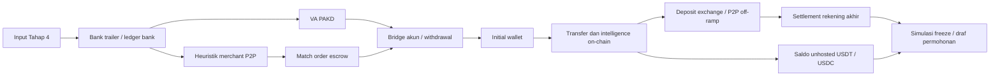

# IASC Cross-Rail Money Trailing — PoC

Proof of Concept Python/FastAPI untuk menelusuri laporan transaksi bank → VA atau P2P → blockchain → rekening cash-out. Ditujukan sebagai bahan demonstrasi teknis bagi Departemen Pengembangan Aplikasi OJK. **Seluruh nama, KYC, ledger, nomor order, alamat, hash, label entitas, saldo, dan hasil tindakan dalam empat skenario adalah data sintetis. Proyek ini tidak berafiliasi dan tidak tersambung ke portal IASC/OJK, bank, PAKD, atau penerbit token.**

## Menjalankan pada MacBook M1

Gunakan Python 3.11 atau lebih baru; pengujian pengembangan memakai Python 3.12 di macOS ARM64. Tidak memerlukan Docker, database, Node.js, browser extension, atau CDN.

Setelah mengunduh ZIP, masuk ke folder yang berisi `main.py`. Untuk mengambil proyek dari GitHub:

```bash
git clone https://github.com/cesartputra/crypto-trails.git
cd crypto-trails
python3 -m venv .venv
source .venv/bin/activate
python -m pip install -r requirements-dev.txt
python -m pytest -q
python -m uvicorn main:app --host 127.0.0.1 --port 8000
```

Buka [dashboard lokal](http://127.0.0.1:8000) atau [schema OpenAPI JSON](http://127.0.0.1:8000/openapi.json). Alternatif Mac: klik dua kali `start.command` atau jalankan `bash start.command`. Launcher memasang dependensi runtime jika belum tersedia, lalu menjalankan server. Pemasangan awal memerlukan internet; setelah dependensi tersedia dan `ARKHAM_API_KEY` kosong, empat demo, aset visual, dan simulasi recovery berjalan tanpa jaringan. `Ctrl+C` menghentikan server. Satu proses Uvicorn cukup untuk demo di perangkat 8 GB.

## Alur presentasi

1. Dashboard membuka skenario pertama otomatis. Pilih salah satu dari empat preset untuk mengisi seluruh field Tahap 4 dan langsung melacaknya.
2. Baca metrik kerugian, dana terlacak, estimasi recoverable, dan badge rute. Nominal terlacak menghitung dana awal yang diatribusikan; total transaksi sepanjang hop tidak dijumlahkan sebagai uang baru.
3. Jalankan animasi untuk menampilkan jejak bertahap. Klik node untuk memeriksa rekening, UID/KYC sintetis, order escrow, timestamp, chain, hash, saldo, dan taint. Geser/zoom atau gunakan fit untuk menavigasi grafik.
4. Pada skenario P2P, periksa bukti transfer bank dibandingkan release escrow. Hold merchant dibatasi transaksi/order terkait; merchant tidak menjadi target freeze seluruh rekening.
5. Pilih aksi recovery yang ditawarkan server. Status berubah sebagai **simulasi**. Untuk blacklist, unduh JSON berstatus **DRAFT** sebagai bahan review penerbit, bukan transaksi on-chain.
6. Gunakan ekspansi pada wallet untuk meminta hop berikutnya. Respons kosong disertai alasan berarti batas data tercapai, bukan bukti dana berhenti bergerak.

| Preset | Jejak yang dibuktikan | Hasil demo |
| --- | --- | --- |
| 1 · P2P full cycle | BNI Rp180 juta → BCA mule → Mandiri merchant MCH-8821 → escrow 11.250 USDT TRC20 → initial wallet → dua cabang → deposit exchange → jual P2P → BRI `034101009988111` | Order on-ramp dan off-ramp terhubung; freeze rekening BRI akhir disimulasikan |
| 2 · Direct VA / loopback | BCA Rp120 juta → mule → VA Tokocrypto → 7.500 USDT → dua hop → deposit Indodax | Freeze akun PAKD penadah disimulasikan |
| 3 · DEX / cold wallet | BRI Rp250 juta → mule → BCA merchant → 15.600 USDT ERC20 → Uniswap V3 dan cold wallet | Draf permohonan Tether untuk exposure 11.000 USDT pada cold wallet |
| 4 · Golden period | Rp95 juta → escrow/PAKD; sebagian masih tersimpan, sebagian sudah ke wallet pertama | Estimasi cakupan saldo yang dapat diamankan 100% pada fixture, tanpa penghitungan ganda |

Angka probabilitas dan recoverable merupakan estimasi kebijakan demo terhadap snapshot saldo, bukan jaminan pengembalian atau model statistik terkalibrasi. Biaya, likuiditas, pergerakan harga, dan putusan pihak berwenang dapat mengubah hasil nyata.

| Preset | Saldo yang masuk estimasi recoverable | Cakupan terhadap laporan | Estimasi peluang demo |
| --- | --- | --- | --- |
| 1 | BRI Rp144 juta + sisa akun PAKD 1.250 USDT × Rp16.000 = **Rp164 juta** | 91,11% | 86,5% |
| 2 | Akun PAKD 7.500 USDT × Rp16.000 = **Rp120 juta** | 100% | 94% |
| 3 | Cold wallet 11.000 USDT × Rp16.000 = **Rp176 juta** | 70,4% | 62% |
| 4 | Escrow Rp60 juta + wallet 2.187,5 USDT × Rp16.000 = **Rp95 juta** | 100% | 98% |

Kurs Rp16.000/USDT adalah konstanta fixture, bukan kutipan pasar. Skenario 1 membayar Rp160 juta ke rekening akhir; saldo tersedia yang masih dapat diamankan Rp144 juta. Skenario 3 mengalokasikan Rp400 ribu sebagai biaya konversi, sehingga Rp250 juta menghasilkan 15.600 USDT. Hold preservasi bukti atas escrow yang sudah dilepas tidak menambah nilai recoverable.

## Arsitektur



| Berkas | Tanggung jawab |
| --- | --- |
| `schemas.py` | Pydantic v2, input Tahap 4, node universal tiga zona, edge, escrow evidence dan aksi recovery |
| `scenarios.py` | Empat fixture transaksi terstruktur dan identitas sintetis |
| `services/bank_trailer.py` | Penelusuran ledger bank secara terbatas dan penilaian perilaku merchant |
| `services/p2p_and_pakd_bridge.py` | VA → akun/withdrawal; pencocokan transfer ↔ escrow; reverse lookup deposit → order jual → rekening akhir |
| `services/arkham_client.py` | Klien async httpx, transfer/intelligence, mode fixture dan batas penelusuran |
| `services/recovery_action.py` | Pemilihan saldo recovery, perlindungan merchant, simulasi tindakan dan paket issuer |
| `main.py` | Orkestrasi FastAPI, penyimpanan trace sementara, endpoint dan penyajian static |
| `static/` | HTML/CSS/JS dan SVG interaktif tanpa build atau dependensi browser eksternal |
| `tests/` | Validasi skenario, determinisme, saldo, input, scope aksi dan adapter Arkham dengan mock |

Frontend menggunakan `node_zone` untuk mengelompokkan zona: `FIAT_BANK`, `CRYPTO_EXCHANGE_BRIDGE`, `ONCHAIN_WALLET`. Rekening merchant tetap berada pada zona fiat, tetapi diberi warna amber berdasarkan `node_type`. Edge korelasi escrow dibedakan dari perpindahan aset; order escrow bukan transfer bank atau transaksi blockchain baru.

Laporan manual yang tidak terikat fixture hanya menghasilkan bukti transaksi yang dimasukkan pengguna beserta peringatan data belum tersedia. Memilih `scenario_id` mewajibkan kecocokan data laporan dengan fixture; mengubah nominal/rekening tidak boleh menghasilkan tuduhan atau order yang direkayasa.

Model taint fixture menggunakan atribusi proporsional: porsi tercemar = saldo teratribusi ÷ total saldo yang tersedia pada saat transfer; outgoing membawa nominal × porsi tersebut dan mengurangi saldo sumber. Saldo bersih yang tercampur menurunkan porsi, dan jumlah yang diteruskan tidak boleh melampaui saldo. Persentase taint wallet menunjukkan komposisi atribusi, bukan persentase dana awal yang berada di wallet itu. Bank ditelusuri hingga empat transfer untuk mencakup korban → Tier-1 → Tier-2 → Tier-3 → VA, sedangkan penelusuran on-chain awal dibatasi tiga hop. DEX/bridge merupakan batas atribusi tanpa bukti lanjutan; ekspansi investigasi dapat ditampilkan tanpa menambah klaim recovery.

## Endpoint

| Method | Path | Input / hasil |
| --- | --- | --- |
| GET | `/api/v1/health` | Status PoC dan konfigurasi mode |
| GET | `/api/v1/trail/scenarios` | Daftar preset beserta laporan Tahap 4 |
| POST | `/api/v1/trail/trace-report` | `IASCTransactionReportInput`; graph, evidence, metrik, dan aksi |
| GET | `/api/v1/trail/address/{address}/expand?trace_id=...&chain=...` | Ekspansi wallet yang menjadi anggota trace |
| POST | `/api/v1/recovery/execute-freeze` | `{ "trace_id": "…", "action_id": "…" }`; hasil simulasi/paket draft |

Contoh menjalankan satu trace dengan standard library Python, setelah server aktif:

```python
import json
from urllib.request import Request, urlopen

base = "http://127.0.0.1:8000"
presets = json.load(urlopen(base + "/api/v1/trail/scenarios"))
report = presets["scenarios"][0]["report"]
request = Request(base + "/api/v1/trail/trace-report",
                  data=json.dumps(report).encode(),
                  headers={"Content-Type": "application/json"})
graph = json.load(urlopen(request))
print(graph["trace_id"], graph["recoverable_amount_idr"])
```

Nominal memakai `Decimal` dan dikirim sebagai string JSON agar perhitungan uang di backend tidak memakai float biner. Timestamp harus memiliki offset zona waktu, misalnya `2026-10-21T09:00:00+07:00`. Field rekening adalah string untuk mempertahankan nol awal.

Pada node bank, `amount_idr` adalah jumlah kumulatif yang diterima pada jalur tersebut; `metadata.remaining_attributed_idr` menunjukkan sisa atribusi pada ledger bank. Saldo tersedia rekening akhir ada pada `metadata.available_balance_idr`. Pada ekspansi yang belum teratribusi, `taint_score_pct: null` berarti belum diketahui, bukan bersih 0%; `balance_status: NOT_FETCHED` berarti saldo belum diambil.

## Arkham dan integrasi yang memerlukan data mitra

`ARKHAM_API_KEY` dibaca hanya di server. Tanpa kunci, tidak ada panggilan Arkham. Empat preset selalu menggunakan fixture agar presentasi dapat diulang, termasuk jika kunci sudah dikonfigurasi. Ekspansi live bersifat opt-in melalui API; bukti live tidak boleh diperlakukan sebagai order/KYC sintetis atau otomatis mengubah kandidat recovery.

```bash
export ARKHAM_API_KEY='kunci-dari-vendor'
export ARKHAM_BASE_URL='https://api.arkm.com'
python -m uvicorn main:app --host 127.0.0.1 --port 8000
```

Default host legacy `https://api.arkhamintelligence.com` mengikuti brief. Dokumentasi resmi Arkham yang diperiksa 21 Oktober 2026 mencantumkan `https://api.arkm.com`; konfirmasikan host, akses chain, parameter, kredit, pagination, dan schema yang berlaku pada kontrak akun Anda. Klien memakai header `API-Key`, endpoint transfer dan intelligence, timeout, serta pembatasan hasil. **Panggilan berbayar/live belum diverifikasi dengan kredensial vendor.**

Arkham menyediakan intelligence on-chain. KYC, UID, mutasi bank, mapping VA, escrow, order P2P, dan settlement rekening akhir harus datang dari bank/PAKD melalui kerja sama yang sah; label alamat saja tidak mengungkap data tersebut. Heuristik merchant merupakan petunjuk investigasi, bukan vonis. Korelasi DEX atau bridge tidak membuktikan kepemilikan output tanpa bukti swap/bridge tambahan.

## Recovery dan paket penerbit token

Server memilih target dan nominal dari trace. Client hanya mengirim ID aksi; nominal/target baru dari client ditolak. Pengulangan aksi yang sama mengembalikan hasil yang sama selama trace masih tersimpan. Target merchant hanya mendapatkan hold yang terikat order dan exposure; freeze rekening penuh dibatasi rekening akhir/akun PAKD yang dinyatakan dalam fixture.

Pada USDT Ethereum, `addBlackList(address)` adalah fungsi berizin; `AddedBlackList(address)` adalah event yang dihasilkan. Pada kontrak USDC, `blacklist(address)` memerlukan peran `blacklister`. Blacklist membatasi alamat untuk token tersebut, **bukan fungsi yang menerima nominal 11.000 USDT**. Nominal di paket adalah exposure/saldo yang didokumentasikan. Paket PoC merupakan draf belum ditandatangani; tidak mengirim transaksi, tidak menggunakan private key, dan tidak mengatasnamakan persetujuan OJK. Identitas kontrak/token native versus wrapped, chain, bukti, kewenangan, dan kewajiban hukum harus diverifikasi sebelum proses issuer nyata. ETH tidak memiliki kemampuan blacklist penerbit seperti USDT/USDC.

## Batas PoC dan langkah integrasi

- Ledger dan KYC contoh tersimpan di kode; tidak ada konektor bank/PAKD, penyimpanan perkara produksi, atau API pemblokiran resmi yang disimulasikan sebagai layanan nyata.
- Trace dan status aksi berada dalam memori satu proses, maksimum 128 trace dengan TTL satu jam, dan hilang saat restart. Grafik dibatasi 256 node/512 edge; pembacaan Arkham live satu halaman maksimum 50 transfer sehingga bukan riwayat lengkap. ID trace bukan kontrol akses produksi. Jalankan hanya di loopback dengan data demo; penerapan nyata memerlukan autentikasi, RBAC, audit tahan perubahan, retensi, serta isolasi perkara.
- Taint adalah atribusi model aliran pada fixture, bukan skor Arkham atau kepastian pidana. Saldo historis, urutan transfer, mixing, swap, bridge, biaya, dan token berbeda memerlukan model lebih lengkap untuk produksi.
- UI tidak menyimpan API key atau memasang script CDN. Semua nominal, alamat dan label demo harus diganti adapter terverifikasi sebelum memakai data nyata.

## Hasil pemeriksaan

Pemeriksaan lokal: **65 pengujian pytest lulus**, sintaks JavaScript dan launcher Bash lulus. Browser memvalidasi pemilihan empat skenario, freeze BRI/Indodax simulasi, hold escrow, unduh draf Tether, expand DEX, input manual tanpa data mitra, dan animasi sampai selesai. Tata letak diperiksa pada panel sempit dan desktop tiga panel; console browser tidak mencatat error JavaScript. Pengujian adapter Arkham memakai mock HTTP; kredensial dan operasi mitra nyata tidak dipakai. Ada satu peringatan deprecation upstream Starlette/TestClient terhadap httpx yang tidak menggagalkan pengujian.

## Referensi verifikasi

- [Portal IASC OJK](https://iasc.ojk.go.id/) — kebutuhan data rekening korban/terlapor, waktu, nominal, serta peran koordinasi lembaga keuangan.
- [Dokumentasi resmi Arkham](https://arkm.com/api/docs) dan [indeks API resmi](https://arkm.com/llms.txt) — akses intelligence dan transfer serta host API saat ini.
- [Protokol dan kontrak resmi Tether](https://tether.to/en/supported-protocols/) — kontrak token berdasarkan jaringan; [USDT Ethereum yang ditautkan penerbit](https://etherscan.io/token/0xdac17f958d2ee523a2206206994597c13d831ec7#code).
- [Sumber kontrak Blacklistable Circle](https://github.com/circlefin/stablecoin-evm/blob/master/contracts/v1/Blacklistable.sol) — fungsi `blacklist` dan pembatasan peran.

Tanggal verifikasi referensi: 21 Oktober 2026. Referensi tidak menyiratkan integrasi atau dukungan institusi terkait terhadap PoC ini.
