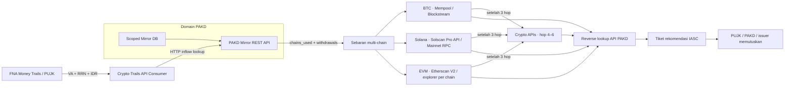

# Crypto-Trails · PAKD Multi-Chain Dispersal & Dedicated Scanners

Dashboard investigasi **FNA → PAKD Scoped Mirror REST API → Bitcoin / Solana / EVM Scanner → rekomendasi dan keputusan institusi**. Satu inflow Rupiah dapat terhubung ke beberapa withdrawal pada chain berbeda. UI menampilkan narasi singkat, kartu sebaran dan jalur per chain agar pembagian dana mudah dibaca.

PoC lokal ini bukan sistem resmi OJK/IASC. Handoff FNA, identitas nasabah PAKD, saldo serta keputusan freeze pada skenario adalah sintetis. Mode live membaca API publik asli dan tidak menyisipkan graph demo ketika provider gagal.

## Menjalankan

Python 3.11+; diuji pada Python 3.12 macOS ARM64. Tidak perlu Docker, database server, CDN atau framework JavaScript. SQLite dan validasi encoding memakai standard library; dependensi Python tetap sama.

```bash
git clone https://github.com/cesartputra/crypto-trails.git
cd crypto-trails
python3 -m venv .venv
source .venv/bin/activate
python -m pip install -r requirements-dev.txt \
  && python -m pytest -q \
  && python -m uvicorn main:app --host 127.0.0.1 --port 8000
```

Pada Mac demo yang sudah disiapkan, aktifkan `source .venv-offline/bin/activate` sebelum menjalankan server. Lingkungan offline hanya lokal dan bergantung pada runtime pembuatnya; tidak disertakan Git/ZIP. `bash start.command` adalah launcher runtime sederhana; Ctrl+C menghentikan server.

Buka [dashboard](http://127.0.0.1:8000/), [referensi API lokal](http://127.0.0.1:8000/docs), atau [kontrak OpenAPI](http://127.0.0.1:8000/openapi.json). Restart server setelah mengganti source, kemudian refresh browser. Instalasi awal memerlukan akses PyPI; jangan menonaktifkan verifikasi TLS untuk mengatasi kegagalan jaringan.

## Arsitektur dan minimisasi data



Aplikasi OJK bertindak sebagai **API consumer**, tanpa membuka koneksi SQL ke database PAKD. SQL hanya berada dalam `pakd_scoped_mirror_provider.py`. Demo menggunakan HTTP ASGI dalam satu proses untuk memisahkan provider/consumer; bukan koneksi ke server produksi PAKD. Endpoint provider tetap terlihat pada OpenAPI.

Tiga tabel scoped: `ojk_scoped_fiat_inflows`, `ojk_scoped_crypto_withdrawals`, dan `ojk_scoped_wallet_registry`. Withdrawal terikat pada `pakd_code`, `user_uid`, dan `linked_inflow_id`; satu inflow boleh memiliki beberapa withdrawal yang sah. Respons inflow API memuat `chains_used` dan daftar `withdrawals`, termasuk:

- ID withdrawal, chain/family dan scanner_provider.
- Token, jumlah Decimal dan `fiat_value_idr` pada snapshot demo.
- Hash withdrawal, initial address dan timestamp.

BTC/SOL tidak dihitung dengan kurs USDT Rp16.000. Setiap cabang memakai nilai fiat yang teratribusi pada withdrawal tersebut; volume transfer berulang antar-hop tidak dijumlahkan sebagai kerugian baru.

Allowlist respons menolak/menghapus field internal yang tidak termasuk scope. Nama kolom seperti `password_hash`, `api_secret`, `internal_orderbook`, `cold_wallet_private_key`, `device_imei`, dan `fee_tier` hanya ditampilkan dalam daftar pengecualian; nilainya tidak diakses atau disinkronkan. NIK dan nama nasabah disamarkan. Desain minimisasi ini bukan sertifikasi kepatuhan UU PDP.

Log API bersifat per trace: endpoint, request, status HTTP, latency, scoped fields dan respons. Semua detail teknis tersedia melalui modal **Log API & Mirror DB PAKD**, bukan memenuhi layar investigasi utama.

## Alur UI

1. **Handoff FNA:** pilih kasus. Detail rekening, RRN, VA dan waktu disimpan pada form opsional yang dapat dibuka.
2. **Cek PAKD Mirror API:** ringkasan menjelaskan nilai inflow dan sebaran chain dalam bahasa sederhana.
3. **Pelacakan scanner:** kartu BTC/Solana/EVM menunjukkan jumlah, initial address dan sumber scanner. Klik kartu/filter untuk fokus pada jalur terkait; pilih Semua Chain untuk melihat fan-out lengkap.
4. **Rekomendasi dan keputusan:** klik node untuk bukti dan kewenangan institusi. Pengiriman rekomendasi tidak langsung mengakui dana dibekukan.

Kanvas memakai swimlane horizontal per chain, dengan konteks FNA/PAKD bersama di sisi kiri. Bukti dan API JSON dipisahkan dari ringkasan. Tema Light/Dark di header disimpan dalam localStorage; kunjungan pertama mengikuti preferensi sistem. API key tidak disimpan di localStorage.

Ikon pada node on-chain, judul swimlane, kartu dan filter memakai SVG lokal dari [0xa3k5/web3icons](https://github.com/0xa3k5/web3icons), commit `3cce0f390cf902f204a1b3d52f485bcc95d2fe9e`. Aset untuk sembilan chain berada di `static/icons/web3icons/`, beserta atribusi dan lisensi MIT. Tidak ada dependensi npm atau CDN baru. Simbol institusi/peran tetap dipakai pada node bank/PAKD; logo jaringan bukan bukti identitas pemilik wallet.

## Kasus default: Rp180 juta tersebar ke tiga chain

**BNI → mule BCA → VA Tokocrypto → tiga withdrawal:**

| Cabang | Nilai awal demo | Jalur akhir |
| --- | --- | --- |
| Bitcoin | Rp70 juta · 0,065 BTC | Initial BTC → wallet perantara → deposit BTC Indodax |
| Solana | Rp50 juta · 185 SOL | Initial SOL → deposit Pintu → P2P off-ramp ke rekening BRI; saldo akhir eligible Rp45 juta |
| Ethereum | Rp60 juta · 3.750 USDT | Initial ERC-20 wallet → unhosted wallet; draft permohonan review issuer |

Nilai awal cabang berjumlah Rp180 juta. Potensi terminal pada snapshot Rp175 juta: Rp70 juta di PAKD, Rp45 juta saldo BRI dan Rp60 juta exposure USDT. Tidak ada nominal dikonfirmasi sampai callback keputusan simulasi; tidak ada jaminan recovery.

Alamat, hash, identitas dan hubungan PAKD pada preset adalah sintetis, meskipun sebagian contoh alamat memakai format/alamat publik nyata. Jangan memakai mapping fixture sebagai bukti kepemilikan nasabah nyata. Enam preset sebelumnya juga dipertahankan: P2P full-cycle, direct VA/loopback, DEX/cold wallet, golden period serta dua bridge EVM Ethereum→Arbitrum/BSC. Semua memakai struktur `chain_dispersals` dan provenance scanner.

## Live Scanner: BTC, Solana, EVM

Pilih chain dan alamat yang sesuai, lalu jalankan live scanner. Default dan batas maksimum adalah **6 hop wallet**: tiga hop awal memakai scanner utama, kemudian Crypto APIs melanjutkan dari wallet batas hop ketiga. Wallet awal tidak dipindai ulang melalui Crypto APIs. Pilihan 1–3 hop hanya memakai scanner utama. Contoh Solana berupa akun publik Wrapped SOL, bukan klaim identitas pengguna.

| Family | Hop 1–3 | Hop 4–6 | Bukti explorer |
| --- | --- | --- | --- |
| Bitcoin | Mempool.space REST; fallback Blockstream Esplora | Crypto APIs Address Latest UTXO | mempool.space/address/... dan /tx/... |
| Solana | Solscan Pro API v2 bila key terisi; Mainnet JSON-RPC bila key kosong | Crypto APIs Address Latest Solana | solscan.io/account/... dan /tx/... |
| EVM | Etherscan V2 `chainid` sesuai jaringan; fallback allowlist per chain tanpa key | Crypto APIs Address Latest EVM | Etherscan, BscScan, Arbiscan, PolygonScan, BaseScan, Optimism explorer |
| TRON | Fixture TRC-20 sintetis saja | Tidak tersedia | Tidak ada live TRON scanner |

**Bitcoin:** riwayat address memakai `/address/{address}/txs`. Bitcoin adalah UTXO: satu transaksi dapat memiliki banyak input, output dan change. Graph menampilkan transaksi dan outputnya tanpa mengklaim bahwa setiap output milik pelaku. Jumlah output bukan nominal dana laporan atau saldo recovery. Alamat dan hash divalidasi, termasuk checksum address.

**Solana dengan Solscan:** `GET /v2.0/account/detail` mengambil saldo lamports dan `GET /v2.0/account/transfer` mengambil sampel transfer native SOL. API key dikirim dalam header `token` hanya ke host resmi Solscan. Filter native SOL memakai alamat penanda dari dokumentasi Solscan, bukan mint Wrapped SOL. Nominal mentah dibagi 10^9 dengan Decimal. Signature, alamat, token, arah dan nominal diperiksa sebelum dijadikan edge; transfer tetap bukan bukti kepemilikan atau atribusi dana korban. SPL-token tracing lengkap belum termasuk.

**Solana tanpa key:** `getSignaturesForAddress` dan `getBalance` mengambil aktivitas serta saldo native dari RPC publik. `getTransaction` dengan `jsonParsed` mengurai transfer native SOL System Program. Signature hanya membuktikan akun direferensikan oleh transaksi; bukan otomatis transfer keluar. Transaksi gagal tidak dipakai sebagai transfer. Aktivitas yang belum dapat diurai tetap ditampilkan sebagai daftar signature dengan link, tanpa membuat edge palsu.

**EVM:** mengambil `txlist`, `tokentx`, dan saldo native. Filter USDT/USDC mengikat kontrak kanonis per chain. `ETH` pada filter berarti native coin jaringan (ETH, BNB, POL). Key Etherscan berlaku sesuai akses/kuota akun. BSC memerlukan key karena tidak ada fallback BSC yang diasumsikan. Fallback Ethereum tidak digunakan sebagai pengganti jaringan lain.

Live dibatasi halaman terbaru, hop, request, node, edge dan deadline; ini bukan seluruh riwayat dan belum memiliki filter tanggal awal/akhir. Metadata menginformasikan provider, waktu pengambilan, batas dan aktivitas yang tidak didukung. Data live tidak menghasilkan skor taint, nilai IDR, recovery atau freeze otomatis.

UI/API menerima 1–6 hop per pemindaian, dengan default 6 hop. Fase utama native membatasi 10 transaksi/signature per alamat, 24 request HTTP dan 60 detik; fase utama EVM membatasi 15 transaksi per kategori/alamat, 36 request dan 90 detik. Kelanjutan Crypto APIs memakai **mode Free: sampel 1 transaksi per kategori/alamat**, maksimum **6 percobaan HTTP termasuk retry**, dan **anggaran reservasi 2.000 kredit**. Anggaran Crypto APIs berlaku bersama untuk seluruh wallet frontier dan kumulatif per trace, termasuk perluasan manual; perluasan tidak memperoleh anggaran baru. Deadline kelanjutan adalah 60 detik untuk native atau 90 detik untuk EVM. Graph otomatis tetap dibatasi 64 node dan 128 edge secara gabungan; hasil dapat berhenti sebelum hop keenam.

Sebelum request, scanner memeriksa apakah estimasi biayanya masih muat dalam anggaran reservasi. Setelah respons, biaya dari header `x-credits-consumed` dicatat sebagai kredit terukur; request tanpa header tersebut memakai estimasi konservatif. Metadata memisahkan `cryptoapis_credits_consumed` dan `cryptoapis_credits_estimated`. Header `x-credits-available`, bila tersedia, dicatat sebagai sisa akun yang teramati, bukan jaminan sisa saat request berikutnya. Biaya aktual provider dapat melebihi reservasi, sehingga 2.000 kredit bukan batas tagihan yang dijamin. Fase Crypto APIs tidak mengambil saldo wallet.

Request Crypto APIs diserialkan secara global **dalam satu proses**, dengan jeda minimal **1,2 detik setelah respons sebelumnya selesai**. HTTP 429 dapat dicoba ulang sekali, tetap memakai anggaran percobaan/kredit yang sama dan mengikuti `Retry-After` hingga 10 detik bila anggaran serta deadline mengizinkan; tanpa header yang valid, jeda retry adalah 2 detik. Jika perlu menunggu lebih lama, anggaran habis, atau retry kembali dibatasi, scanner mengembalikan hasil parsial.

Menurut [paket Free Crypto APIs](https://cryptoapis.io/pricing), akun provider memperoleh 100.000 kredit bulanan, soft throughput 100 kredit/detik dan hard throughput 1.000 kredit/detik. Satuan throughput adalah **kredit, bukan jumlah request**. Satu request terisolasi pun dapat melampaui soft throughput dan terkena pengali konsumsi; jeda 1,2 detik tidak menjamin bebas pengali. Lihat [Data Flow Limiting resmi](https://developers.cryptoapis.io/v-2.2024-12-12/RESTapis/general-information/data-flow-limiting). Pencatatan lokal per trace tidak mencakup pemakaian akun oleh klien lain atau worker/proses server lain; gunakan batas dan pemantauan akun provider untuk anggaran akun bersama.

Crypto APIs menggunakan GET pada `https://rest.cryptoapis.io/addresses-latest/...`, dengan key lewat header `X-API-Key`. EVM mencakup Ethereum, BSC (`binance-smart-chain`), Polygon, Arbitrum, Optimism dan Base. Nilai display Decimal tidak dibagi wei/lamports lagi. Token EVM tetap diperiksa terhadap kontrak kanonis USDT/USDC; Bitcoin memakai node transaksi/input/output dan melanjutkan outpoint yang cocok. Solana hanya membaca `nativeMovements`, bukan menyimpulkan transfer dari signer atau perubahan saldo. Status eksekusi Solana tidak disediakan oleh endpoint ini dan tidak diklaim terverifikasi.

**Cakupan Crypto APIs:** transaksi terbaru BTC/EVM hingga 14 hari; Solana hingga 1 hari. Ini hanya berlaku pada fase kelanjutan, bukan pada seluruh hasil fase utama. Tidak ada sinkronisasi Address History atau pengambilan riwayat genesis otomatis. Setiap node/edge mempertahankan provider aslinya; metadata graph memuat provider gabungan, request per fase dan `wallet_hops_traced`. Hop Bitcoin pada layout memiliki lapisan transaksi di antara wallet; metrik live menghitung hop wallet. Perluasan manual setelah hop ketiga juga memakai Crypto APIs dan berhenti pada hop keenam.

## Konfigurasi `.env`

Salin `.env.example` ke `.env` bila belum ada:

```dotenv
ETHERSCAN_API_KEY=
ETHERSCAN_BASE_URL=https://api.etherscan.io/v2/api
ETHERSCAN_FALLBACK_EXPLORER_URL=https://eth.blockscout.com/api
SOLSCAN_API_KEY=
SOLSCAN_BASE_URL=https://pro-api.solscan.io/v2.0
CRYPTOAPIS_API_KEY=
CRYPTOAPIS_BASE_URL=https://rest.cryptoapis.io
```

`.env` dibaca otomatis dari folder `main.py`; environment shell lebih utama. Key opsional UI hanya berlaku pada request itu. BTC dan Solana tidak menerima key Etherscan. Key tidak masuk ke graph, log API PAKD, ekspor atau respons error validasi. `.env` diabaikan Git.

Isi `CRYPTOAPIS_API_KEY` dengan key Crypto APIs yang memiliki akses mainnet dan endpoint Address Latest, lalu restart server. Key ini hanya diterima dari `.env`/environment server; tidak ada field Crypto APIs key di UI atau body API. Host selain `https://rest.cryptoapis.io` ditolak. Bila kelanjutan diperlukan tetapi key kosong/tidak valid, API mengembalikan error konfigurasi atau autentikasi; pilih maksimum 3 hop bila hanya ingin fase awal. Wallet tanpa frontier hop ketiga tidak mengirim request Crypto APIs. Batas Free merupakan default kode, tanpa variabel konfigurasi baru.

**Hasil parsial Crypto APIs:** HTTP 402 (kredit), HTTP 403 (izin/paket), HTTP 429 setelah retry terbatas, anggaran lokal habis atau deadline kelanjutan mengembalikan HTTP 200 dengan `live_metadata.partial=true` dan `continuation_status` berupa `CREDIT_LIMIT`, `ACCESS_LIMIT`, `RATE_LIMIT`, `BUDGET_LIMIT` atau `TIMEOUT`. Graph mempertahankan bukti scanner utama serta bukti Crypto APIs yang sudah berhasil diperoleh; UI menampilkan hop aktual dibanding jumlah yang diminta dan alasan berhenti. Tidak ada transaksi simulasi pengganti. HTTP 401, HTTP 500, respons malformed dan kegagalan jaringan tetap fatal, dengan pesan tersanitasi yang tidak memuat key atau isi error mentah provider. `hasMore=true` sendiri hanya menandai sampel terpotong, bukan status parsial karena pembatasan layanan.

Isi `SOLSCAN_API_KEY` dengan key [Solscan Pro API v2](https://pro-api.solscan.io/pro-api-docs/v2.0/docs) yang aktif, lalu restart server. Key terisi memilih adapter Solscan; key kosong memilih RPC publik. `SOLSCAN_BASE_URL` hanya menerima endpoint HTTPS resmi `https://pro-api.solscan.io/v2.0`. Environment shell lebih utama daripada `.env`. Simpan key hanya di `.env` lokal; `.env.example` tetap kosong.

Error Solscan dibedakan: HTTP 401 biasanya berarti autentikasi ditolak (periksa key/aktivasi), HTTP 403 berarti akses ditolak (periksa izin/paket), HTTP 429 berarti batas permintaan tercapai. Namun Solscan juga memakai HTTP 401 dengan pesan `Unauthorized: Please upgrade your api key level.` saat level key tidak mengizinkan endpoint akun. Pesan khusus ini dikenali sebagai pembatasan paket: scanner melanjutkan lewat Solana Mainnet RPC publik, menampilkan peringatan dan metadata `fallback_from=SOLSCAN_PRO_API`, `fallback_reason=SOLSCAN_PLAN_REQUIRED`. Provider pada node/edge tetap RPC, dan key Solscan tidak dikirim ke RPC. Batas request/deadline berlaku gabungan untuk kedua provider.

Key Solscan invalid, kuota dan kegagalan jaringan tetap dilaporkan sebagai error; tidak dianggap otomatis sebagai pembatasan paket. Tidak ada transaksi demo pengganti. Endpoint `account/detail` berisi identitas teknis/saldo akun; riwayat transfer diambil dari endpoint terpisah `account/transfer`.

Layanan publik dapat menolak permintaan atau terkena rate limit. Kegagalan fatal mengembalikan error yang jelas; pembatasan kelanjutan Crypto APIs mengikuti perilaku parsial di atas. Hasil demo deterministik hanya berasal dari mode skenario. Akses live semua provider/key belum otomatis terjamin oleh keberhasilan tes mock.

## Bridge EVM dan batas atribusi

Deteksi bridge memakai kamus kontrak terikat chain beserta referensi publik. Auto-scan mencari kandidat penerimaan pada alamat sama di chain tujuan, aset sama, rentang waktu 2 jam, dan toleransi jumlah. Setelah kandidat ditemukan, trailing di chain tujuan dilanjutkan.

Deteksi kandidat bridge otomatis berlaku pada fase scanner utama. Fase Crypto APIs melanjutkan chain setiap wallet frontier; belum mendekode swap/pesan bridge baru pada hop 4–6. Kedalaman tetap dibatasi secara keseluruhan saat pivot, tanpa mengulang kedalaman dari nol.

Garis live berstatus `CANDIDATE_UNVERIFIED`, bukan bukti settlement. Swap, perubahan aset/alamat, relayer dan aktivitas pool dapat memutus atribusi. Decoder penuh swap Uniswap dan pesan bridge belum tersedia. BTC↔Solana↔EVM pada kasus default adalah **fan-out withdrawal dari PAKD**, bukan klaim pelacakan bridge lintas-family secara live.

## Governance

IASC menyiapkan rekomendasi; PUJK/PAKD atau issuer terkait memutuskan dan mengeksekusi tindakan. PoC ini hanya mensimulasikan dispatch dan callback:

`NOT_SENT → SENT_WAITING_DECISION → APPROVED / PARTIAL / REJECTED_BY_INSTITUTION`

Confirmed tetap nol saat tiket dikirim. Persetujuan dibatasi permohonan dan saldo eligible yang teratribusi; keputusan terminal immutable dan replay identik idempoten. Hold P2P hanya pada order terkait. Draft issuer USDT/USDC tidak memakai private key, signing, atau broadcast; pembatasan issuer pada seluruh alamat tidak mendukung freeze nominal parsial. Bitcoin/Solana tidak dianggap memiliki fungsi blacklist issuer universal.

Evidence packet memuat snapshot FNA, respons API PAKD, rincian withdrawal/cabang, graph dan digest. Seluruh keputusan pada preset tetap simulasi. Handoff manual tanpa snapshot FNA terverifikasi tidak menghasilkan rekomendasi otomatis.

## Endpoint dan modul

| Endpoint | Fungsi |
| --- | --- |
| `GET /api/v1/trail/scenarios` | Katalog kasus, default multi-chain dispersal |
| `POST /api/v1/trail/trace-report` | Handoff FNA → API PAKD → graph + chain_dispersals |
| `POST /api/v1/trail/live-scanner` | Unified scanner: wallet_address, source_chain, max_hops, token_filter, direction, etherscan_api_key?, auto_scan_cross_chain?, simulate_fna_and_mirror_origin? |
| `POST /api/v1/trail/live-etherscan` | Alias kompatibilitas endpoint live sebelumnya |
| `POST /api/v1/pakd-mirror-api/{pakd_code}/inflow-lookup` | Inflow + chains_used + daftar scoped withdrawals |
| `POST /api/v1/pakd-mirror-api/{pakd_code}/wallet-lookup` | Reverse wallet lookup yang terikat chain |
| `POST /api/v1/pakd-mirror-api/{pakd_code}/p2p-lookup` | Referensi P2P off-ramp scoped |
| `GET /api/v1/mirror-db/records` | Preview schema/data scoped lewat consumer API |
| `POST /api/v1/governance/send-freeze-request` | Dispatch rekomendasi simulasi |
| `POST /api/v1/governance/simulate-institution-decision` | Callback keputusan simulasi |
| `POST /api/v1/recovery/execute-freeze` | 410 Gone |

`chains.py` berisi family, scanner, validasi dan explorer. `multichain_scanner.py` mengarahkan BTC/Solana/EVM. `etherscan_client.py` menangani EVM/bridge. `pakd_scoped_mirror_provider.py` memiliki SQLite/REST; `pakd_api_consumer.py` menjaga boundary HTTP scoped. `scenario_trailer.py` dan `p2p_and_pakd_bridge.py` membangun graph sintetis; `recovery_action.py` menjaga keputusan institusi.

## Pengujian dan batas operasional

Jalankan `python -m pytest -q`, `node tests/frontend_theme_selfcheck.cjs`, `node tests/frontend_guided_selfcheck.cjs`, `node tests/frontend_dashboard_selfcheck.cjs`, `node tests/frontend_network_selfcheck.cjs`, dan `node tests/frontend_forensic_workspace_selfcheck.cjs`. Suite memakai SQLite provider nyata, HTTP ASGI dan HTTP/RPC mock agar dapat berjalan offline; smoke jaringan dijalankan terpisah.

Dashboard memiliki sidebar kasus/live scanner, graph kartu forensik empat kolom, inspector, pencarian transaksi, serta light/dark mode. Pilihan **7H / 30H / 90H / Semua** berarti hari dan hanya menyaring sampel yang sudah dimuat; tidak meminta riwayat tambahan dari provider. Batas waktu live dihitung dari waktu sekarang, sedangkan skenario sintetis relatif terhadap timestamp transaksi terakhir pada fixture. Transaksi tanpa timestamp tetap terlihat pada Semua. Filter tidak mengubah bukti asli atau isi ekspor JSON.

Graph memakai kolom **Sumber → Wallet awal (hop 0) → Perantara (hop 1) → Titik akhir/target (hop 2+)**, dengan hop sebenarnya tetap tersedia hingga enam. Kartu 210 × 84 memiliki jarak vertikal kosong 110px. Fit to Screen menyesuaikan lebar sampai 100%; jejak panjang digulir vertikal agar teks tetap terbaca. Pada layar lebar inspector berada di kanan; pada layar lebih kecil inspector berada di bawah graph.

Satu panah merangkum semua relasi searah pada pasangan alamat yang sama. Inspector menguraikan seluruh anggota, termasuk langkah PAKD yang diringkas. Ketebalan 2–8px dan sorotan nilai besar dibandingkan dalam aset/chain/kontrak yang sama, atau nilai IDR/USD yang memang tersedia; tidak ada konversi harga token atau penjumlahan lintas aset. Koneksi ke target beratribusi diprioritaskan; kandidat bridge tetap berlabel kandidat dan tidak memperoleh kepastian dari sorotan visual.

**Fokus Jalur Utama** aktif secara default: menyembunyikan transfer nol dan token yang tidak terverifikasi di luar aset utama/pilihan trace. Transfer mikro di bawah 0,1% transfer terbesar dalam unit aset yang sama juga disembunyikan; koneksi nonnol pada aset utama/terverifikasi ke/dari exchange atau bridge tetap dipertahankan. Lebih dari delapan wallet biasa per kolom diringkas menjadi kelompok yang bisa dibuka sebagai daftar; exchange/PAKD, bridge, sumber, dan seed tetap terlihat. Matikan fokus untuk menampilkan kembali seluruh simpul. Tampilan **Urutan Jejak Hop-by-Hop** memakai seluruh bukti asli dalam filter chain/waktu, termasuk spam yang tidak ditampilkan di peta. Tombol rekomendasi hanya membuka permohonan governance yang sudah ada; label exchange publik tidak menghasilkan tiket freeze otomatis. Minimap mengikuti pan, zoom, dan gulir. Posisi, peran, dan sorotan visual tidak membuktikan kepemilikan maupun atribusi dana laporan.

Indikator risiko memakai `taint_score_pct` yang tersedia pada fixture sintetis, dengan ambang warna visual 0–39 rendah, 40–69 sedang dan 70–100 tinggi. Nilai header adalah skor fixture tertinggi dalam trace, sementara inspector memakai skor simpul yang dipilih. Ini bukan model risiko AML yang terverifikasi. Transaksi/hasil live tanpa skor menampilkan **Belum dinilai**; angka contoh 92 tidak ditanam sebagai skor live.

Smoke publik 22 Oktober 2026 berhasil mengakses Mempool.space, Solana Mainnet RPC dan Ethereum Blockscout. Pada sampel yang diperiksa tidak ada outbound native yang dapat diurai; hasil kosong bukan bukti tidak adanya transaksi sepanjang riwayat. Solana tetap mencatat signature gagal, instruksi yang tidak didukung serta versi transaksi yang belum didukung tanpa mengarang transfer. Akses Etherscan dengan key/kuota akun dan konektor PAKD produksi belum diuji langsung.

Uji langsung Solscan dengan konfigurasi lokal pada tanggal tersebut mendapat HTTP 401 dengan pesan untuk meningkatkan level API key. Akses endpoint akun Solscan belum tersedia pada key yang diuji; jalur sukses adapter Solscan diverifikasi dengan respons HTTP mock sesuai kontrak API. Scanner dapat memakai RPC publik dengan penjelasan sumber data, tanpa mengubah key atau paket akun.

State lokal maksimum 128 trace/1 jam dan database in-memory hilang saat restart. Tidak ada autentikasi lembaga, mTLS, callback mitra produksi atau audit durable. Jalankan pada loopback dengan data sintetis. Integrasi produksi memerlukan perjanjian akses PAKD, dasar pemrosesan, otorisasi perkara, retensi dan monitoring; biaya demo tidak mencerminkan biaya operasi produksi.

Referensi: [Mempool REST](https://mempool.space/docs/api/rest), [Blockstream Esplora](https://github.com/Blockstream/esplora/blob/master/API.md), [Solana signatures](https://solana.com/docs/rpc/http/getsignaturesforaddress), [Solana transactions](https://solana.com/docs/rpc/http/gettransaction), [Solscan account detail](https://pro-api.solscan.io/pro-api-docs/v2.0/reference/v2-account-detail), [Solscan account transfer](https://pro-api.solscan.io/pro-api-docs/v2.0/reference/v2-account-transfer), [Etherscan V2](https://docs.etherscan.io/introduction). Dokumentasi diperiksa pada 22 Oktober 2026.

Integrasi kelanjutan diperiksa terhadap [Crypto APIs overview](https://developers.cryptoapis.io/v-2.2024-12-12-175/RESTapis/general-information/overview), [EVM transactions](https://developers.cryptoapis.io/v-2.2024-12-12-175/RESTapis/address-latest-evm/list-confirmed-transactions-by-address-evm/get), [token transfers](https://developers.cryptoapis.io/v-2.2024-12-12/RESTapis/address-latest-evm/list-confirmed-tokens-transfers-by-address-evm/get), serta endpoint Address Latest UTXO/Solana pada 23 Oktober 2026. Tes memakai fixture HTTP; keberhasilan tes tidak membuktikan izin paket/key live.
